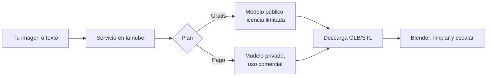

# Servicios comerciales de IA 3D (Tripo y similares)

Parte de: [[39-IA-Modelado-3D/01 Conceptos/_Índice Conceptos|Conceptos]]

> [!info] Cómo avanzar
> `progreso`: **pendiente** → **viendo** (estudiando) → **visto** (contestaste la autoevaluación sin abrir las respuestas) → **dominado** (hiciste el laboratorio o lo aplicaste de verdad).

## Contenido

### Qué es
Son plataformas web donde subes una imagen o escribes un texto y recibes un modelo 3D generado en sus servidores. **Tripo** (de VAST, la misma empresa que publicó TripoSR como código abierto) es el ejemplo más conocido; otros del mismo tipo son Meshy y Rodin (Hyper3D). Corren modelos más grandes y recientes que los que caben en tu GTX 1660 Ti, y añaden extras como texturas PBR, retopología automática, segmentación por partes o rigging.

### Cómo funciona
1. Creas una cuenta y recibes **créditos** (en planes gratuitos, una cantidad mensual limitada).
2. Cada generación, retextura o refinado **consume créditos**.
3. El modelo se genera en la nube y lo descargas en GLB, OBJ, FBX, STL u otros formatos según el plan.
4. Según el plan, el modelo queda **público** (visible en su galería) o **privado**, y con o sin derecho a uso comercial.

### Lo que conviene saber de Tripo
Según un comparador de precios que dice haber verificado los datos en octubre de 2026, el plan gratuito de Tripo da unos **200 créditos al mes**, con modelos **públicos** bajo licencia **CC BY 4.0** (piden atribución) y **sin uso comercial**; los modelos privados y el uso comercial son de los planes de pago. Las cifras de créditos, precios y formatos cambian seguido y otros sitios dan números distintos: confírmalo en [tripo3d.ai](https://www.tripo3d.ai) el día que lo uses (Pendiente de confirmar). Lo mismo aplica a Meshy y Rodin (Pendiente de confirmar).

### Local frente a servicio
| | Tu PC (TripoSR, Hunyuan3D-2mini) | Servicio (Tripo y similares) |
|---|---|---|
| Costo | Gratis, solo luz | Créditos; gratis limitado |
| Calidad de forma | Buena para figuras simples | Generalmente mayor |
| Textura | Limitada en 6 GB | Texturas PBR detalladas |
| Privacidad | Total | Subes tus imágenes a un tercero |
| Derechos | Según licencia del modelo (MIT, Tencent, Stability) | Según términos del servicio y plan |
| Instalación | Python, CUDA, a veces compilar | Ninguna |

### Ejemplo
Quieres comparar: con la misma foto de una alcancía de barro, generas en local con TripoSR y en el plan gratuito de Tripo. Exportas ambos GLB a Blender, los escalas a 100 mm y comparas silueta, espalda y detalle. Si el de Tripo es claramente mejor y la pieza es para regalar (no para vender), el plan gratuito te basta, **siempre que cumplas la atribución** que pida la licencia. Si quieres vender la impresión, necesitas un plan que permita uso comercial o usar un modelo local cuya licencia lo permita ([[Licencias de modelos de IA 3D]]).

### Qué revisar en los términos antes de imprimir o vender
- **Propiedad del resultado:** ¿es tuyo, del servicio, o compartido?
- **Uso comercial en tu plan:** muchos planes gratuitos lo prohíben.
- **Visibilidad:** si el modelo queda público, otros pueden descargarlo.
- **Entrenamiento:** si pueden usar tus imágenes o modelos para entrenar su IA.
- **Atribución:** si la licencia (p. ej. CC BY) te obliga a dar crédito.

Recuerda además que en México una obra hecha solo por IA puede no tener derechos de autor ([[Propiedad y uso comercial de modelos generados por IA]]).

### Cuándo tiene sentido usar un servicio
- La pieza necesita detalle o textura que tu GPU de 6 GB no logra.
- Quieres una referencia de "lo mejor posible" para comparar con tu flujo local.
- Necesitas extras (retopología, partes) que no tienes en local.

Para practicar, iterar y piezas que de todos modos vas a limpiar e imprimir en un color, el flujo local gratuito es suficiente ([[De la IA a la impresora (flujo completo)]]).

### Errores comunes
1. **Vender lo generado en un plan gratuito no comercial.** Lee la licencia del plan; cambia según el servicio.
2. **Subir bocetos confidenciales.** Si es un producto no público, genera en local.
3. **Gastar créditos en imágenes malas.** Prepara la imagen primero ([[Qué imágenes funcionan mejor para IA 3D]]).
4. **Imprimir la descarga sin revisar.** Aunque venga más limpia, revisa escala, grosor y base en Blender.

### Para profundizar
- [Sitio oficial de Tripo](https://www.tripo3d.ai)
- [TripoSR, el modelo abierto de VAST y Stability AI](https://github.com/VAST-AI-Research/TripoSR)
- [TripoSG, modelo de forma abierto de VAST (MIT)](https://huggingface.co/VAST-AI/TripoSG)

## Autoevaluación

Contesta primero en voz alta o en papel; luego despliega la respuesta.

> [!question]- ¿Qué ofrecen servicios como Tripo frente a correr modelos en local?
> Modelos más grandes y recientes en servidores con mucha VRAM, texturas, retopología y a veces segmentación por partes, sin instalar nada. A cambio dependes de créditos/cuotas, de sus términos de uso y subes tus imágenes a terceros.

> [!question]- ¿Qué revisas en los términos antes de imprimir o vender algo generado en un servicio?
> Quién es dueño del resultado, si el plan gratuito permite uso comercial, si el modelo queda público y si pueden usar tus imágenes para entrenar. Las condiciones cambian: revísalas en el sitio de cada servicio el día que lo uses. Ver [[Propiedad y uso comercial de modelos generados por IA]].

> [!question]- ¿Cuándo tiene sentido usar un servicio en vez de tu PC?
> Cuando necesitas una pieza muy detallada o con textura y tu NVIDIA GTX 1660 Ti de 6 GB no alcanza, o para comparar contra lo que obtienes en local. Para practicar y para piezas que vas a limpiar de todos modos, el flujo local gratuito es suficiente.

