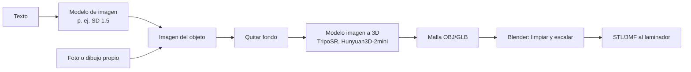

# Texto a 3D e imagen a 3D

Parte de: [[39-IA-Modelado-3D/01 Conceptos/_Índice Conceptos|Conceptos]]

> [!info] Cómo avanzar
> `progreso`: **pendiente** → **viendo** (estudiando) → **visto** (contestaste la autoevaluación sin abrir las respuestas) → **dominado** (hiciste el laboratorio o lo aplicaste de verdad).

## Contenido

### Qué es
Son las dos formas más comunes de pedirle a una IA un objeto 3D. En **imagen a 3D** le das una foto o un dibujo de un objeto y el modelo deduce la forma completa, incluida la parte que no aparece en la imagen. En **texto a 3D** describes el objeto con palabras ("un búho de cerámica con lentes") y el sistema produce la malla. Servicios como Tripo ofrecen ambas en la misma página, y por eso parecen magia; en la práctica, casi todos los sistemas de texto a 3D hacen primero **texto → imagen** y luego **imagen → 3D**. Entender imagen a 3D es entender el corazón de ambos.

### Cómo funciona

1. **Entrada.** En texto a 3D, un generador de imágenes convierte la descripción en una vista del objeto (a veces varias vistas). En imagen a 3D, tú pones esa imagen.
2. **Preparación.** Se quita el fondo y se centra el objeto ([[Quitar el fondo de una imagen]]).
3. **Inferencia 3D.** El modelo predice una representación 3D y la convierte en malla ([[Cómo funciona un modelo de imagen a 3D]]).
4. **Salida.** Recibes casi siempre un **OBJ o GLB** con color por vértice o textura, en una escala arbitraria (la figura puede medir "1.6 unidades").

Lo que la IA **no** te da: medidas reales, una base plana, paredes con grosor imprimible ni garantía de que la malla esté cerrada. Eso lo agregas tú en [[Limpiar un modelo generado por IA en Blender]].

### Ejemplo
Quieres un llavero de un ajolote para imprimir en tu [[Elegoo Centauri 2 Combo]].
- **Ruta texto a 3D (en local):** en ComfyUI generas con SD 1.5 "cute axolotl figurine, full body, three-quarter view, plain white background" ([[Stable Diffusion en 6 GB de VRAM]]). Eliges la mejor de 4 imágenes, **cierras ComfyUI** y pasas la imagen a TripoSR.
- **Ruta imagen a 3D:** dibujas el ajolote en papel con sombreado simple, le tomas foto con el iPhone 15 Pro con luz pareja y la pasas directo a TripoSR.

En ambos casos el paso de 3D es el mismo; lo que cambia es de dónde sale la imagen. Por eso en una GTX 1660 Ti de 6 GB conviene separar etapas: cada programa usa la VRAM por turnos en lugar de competir por ella ([[VRAM - medirla y qué hacer cuando no alcanza]]).

### La parte trasera es inventada
Con una sola imagen, el modelo nunca "vio" la espalda del objeto. Lo que genera ahí es una suposición basada en miles de objetos parecidos con los que se entrenó: puede salir lisa, simétrica al frente o con detalles que no existen. Si necesitas que todos los lados sean fieles (una pieza real, un regalo con detalles en la espalda), tienes tres caminos: usar un modelo que acepte **varias vistas** (Hunyuan3D tiene variantes multivista), **escanear** el objeto ([[Fotogrametría y escaneo con iPhone]]) o **esculpir** la espalda en Blender ([[Escultura digital en Blender]]).

### Cuándo usarlo y cuándo no
- **Imagen a 3D** cuando tienes un dibujo, foto o concepto visual claro; es la ruta más controlable y la que mejor funciona en 6 GB.
- **Texto a 3D** cuando solo tienes la idea y quieres explorar variantes rápido; en un servicio en la nube es cómodo, en local es "SD + imagen a 3D".
- **Ninguno de los dos** para piezas con medidas exactas (soportes, cajas, repuestos): ahí va CAD ([[IA vs CAD vs escaneo (cuándo usar cada uno)]]).

### Errores comunes
1. **Esperar que la espalda sea fiel.** No está en los datos; revísala siempre al girar el modelo.
2. **Encadenar texto→imagen→3D en un solo proceso en 6 GB.** Los dos modelos compiten por la VRAM y sale `CUDA out of memory`. Genera, cierra, y luego convierte.
3. **Imprimir la salida tal cual.** La malla viene sin escala real, a veces abierta y con base redonda. Siempre pasa por Blender.
4. **Pedir varios objetos en una sola imagen.** El modelo los funde en una masa. Un objeto por imagen.

### Para profundizar
- [TripoSR en GitHub](https://github.com/VAST-AI-Research/TripoSR)
- [Hunyuan3D-2 en GitHub](https://github.com/Tencent/Hunyuan3D-2)
- [TRELLIS (imagen y texto a 3D) en GitHub](https://github.com/microsoft/TRELLIS)

## Autoevaluación

Contesta primero en voz alta o en papel; luego despliega la respuesta.

> [!question]- ¿Qué diferencia hay entre texto a 3D e imagen a 3D?
> **Imagen a 3D**: le das una foto o dibujo de un objeto y el modelo infiere la forma completa (incluida la parte que no se ve). **Texto a 3D**: describes el objeto con palabras; casi siempre el sistema genera primero una imagen (texto → imagen) y luego hace imagen → 3D. Por eso en local conviene dominar primero imagen a 3D.

> [!question]- ¿Por qué en tu equipo empezarías por imagen a 3D y no por texto a 3D?
> Porque con una NVIDIA GTX 1660 Ti de 6 GB cada etapa debe caber por separado en la VRAM. Puedes generar la imagen con Stable Diffusion 1.5 (o dibujarla), cerrar ese programa y luego correr TripoSR o Hunyuan3D-2mini. Encadenar todo en un solo proceso suele agotar la memoria. Ver [[VRAM - medirla y qué hacer cuando no alcanza]].

> [!question]- ¿Qué obtienes al final y qué falta para imprimirlo?
> Normalmente una malla (OBJ o GLB) con colores por vértice o textura, en una escala arbitraria. Para imprimir falta: escalar a milímetros, cerrar la malla, revisar grosores, dar una base plana y exportar STL/3MF. Ver [[Limpiar un modelo generado por IA en Blender]].

> [!question]- Error común: esperar que la parte de atrás salga igual que en el objeto real. ¿Por qué no pasa?
> Con una sola imagen la parte trasera **no existe** en los datos: el modelo la *inventa* con lo que aprendió de objetos parecidos. Si necesitas fidelidad en todos los lados, usa varias vistas o escaneo ([[Fotogrametría y escaneo con iPhone]]).

