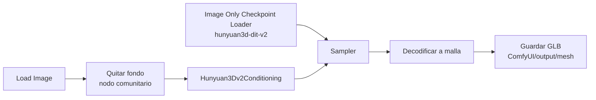

# ComfyUI para generación 3D

Parte de: [[39-IA-Modelado-3D/02 Entorno local/_Índice Entorno local|Entorno local]]

> [!info] Cómo avanzar
> `progreso`: **pendiente** → **viendo** (estudiando) → **visto** (contestaste la autoevaluación sin abrir las respuestas) → **dominado** (hiciste el laboratorio o lo aplicaste de verdad).

## Contenido

### Qué es
**ComfyUI** es una interfaz gratuita y de código abierto para modelos de difusión donde armas el proceso conectando **nodos** en un lienzo: cargar imagen → quitar fondo → modelo 3D → guardar GLB. Nació para Stable Diffusion, pero hoy tiene soporte nativo para algunos modelos 3D (Hunyuan3D 2.0 y 2.1) y muchos nodos de la comunidad para otros. Sirve para tener **un solo programa** que haga desde la imagen de entrada hasta la malla, y guardar el flujo para repetirlo.

### Cómo funciona

- Cada nodo hace una cosa; los cables pasan imágenes, modelos o latentes.
- ComfyUI **carga y descarga** modelos de la VRAM según los necesita cada etapa, y puede descargar partes a la RAM con `--lowvram`.
- Un flujo se guarda como JSON (o dentro de un PNG) y se puede compartir.

**Soporte nativo de Hunyuan3D.** Según la [guía oficial de ComfyUI](https://docs.comfy.org/tutorials/3d/hunyuan3D-2), hay flujos para Hunyuan3D 2.0 (una vista), 2.0 MV (multivista: frente, lados y espalda, aunque basta el frente), 2.0 MV Turbo y 2.1 (un checkpoint de unos 7.4 GB). La salida es un **GLB sin textura** en `ComfyUI/output/mesh`; la generación de textura nativa todavía no está soportada según esa guía. La misma página cita, de la descripción general del proyecto, unos 5 GB de VRAM para 2mini y 6 GB para la forma del modelo estándar.

**Nodos comunitarios.** ComfyUI-3D-Pack, ComfyUI-Hunyuan3DWrapper (incluye textura) o nodos para TRELLIS.2. Traen dependencias compiladas y a veces piden versiones específicas de PyTorch.

### Por qué te conviene en la GTX 1660 Ti
- **Detecta tarjetas GTX 16 y evita FP16** por defecto, lo que esquiva los NaN ([[Tarjetas GTX 16 y media precisión (FP16)]]).
- **Gestiona la memoria por etapas:** SD 1.5 se descarga antes de cargar el modelo 3D, en lugar de tener dos programas compitiendo.
- **`--lowvram`** para cuando la forma no cabe completa.
- Todo el flujo (prompt → imagen → 3D) queda en un archivo reutilizable.

### Ejemplo: instalación portable y primer flujo 3D
```powershell
# 1) Descarga el paquete portable para Windows/NVIDIA desde el GitHub de ComfyUI y descomprímelo en C:\ComfyUI
# 2) Arranca (ajusta el .bat según el paquete; agrega --lowvram si falta memoria)
cd C:\ComfyUI
.\run_nvidia_gpu.bat
# 3) Abre http://127.0.0.1:8188 en el navegador
```
Luego, siguiendo la guía oficial: descarga `hunyuan3d-dit-v2-0`, renómbralo a `hunyuan3d-dit-v2.safetensors`, colócalo en la carpeta de checkpoints, arrastra el flujo de ejemplo al lienzo, carga tu imagen sin fondo y ejecuta. Mide VRAM con `nvidia-smi -l 1` mientras corre. Nombre exacto del `.bat` y carpetas: revisa el README del paquete que descargues (Pendiente de confirmar para la versión actual).

### Cuándo usarlo y cuándo no
- **Úsalo** si ya generas imágenes con SD 1.5 y quieres encadenar el 3D, o si quieres guardar y repetir flujos.
- **Usa el Gradio del repo** si solo quieres probar un modelo rápido o necesitas una opción que ComfyUI no expone ([[Interfaces Gradio de los modelos 3D]]).
- **Usa la nube** para TRELLIS.2 o para textura de Hunyuan3D: en 6 GB no es realista.

### Errores comunes
1. **Instalar muchos paquetes de nodos 3D a la vez.** Cada uno trae dependencias que pueden romper la instalación. Instala uno, prueba, y si vas a experimentar usa una **copia aparte** de ComfyUI.
2. **Usar el gestor de nodos sin leer qué instala.** Algunos cambian la versión de PyTorch del entorno embebido.
3. **Olvidar renombrar o ubicar los modelos.** El nodo no los encuentra y el error no siempre es claro.
4. **Esperar textura del flujo nativo.** La salida nativa es solo forma; pinta los colores en el laminador ([[Separar un modelo por colores para CANVAS]]).

### Para profundizar
- [ComfyUI en GitHub](https://github.com/Comfy-Org/ComfyUI)
- [Guía oficial de Hunyuan3D-2 en ComfyUI](https://docs.comfy.org/tutorials/3d/hunyuan3D-2)
- [Blog de ComfyUI: soporte nativo de Hunyuan3D 2.0 y multivista](https://blog.comfy.org/p/hunyuan3d-20-and-muitiview-native)

## Autoevaluación

Contesta primero en voz alta o en papel; luego despliega la respuesta.

> [!question]- ¿Qué es ComfyUI y por qué sirve para IA 3D?
> Una interfaz de [nodos](https://github.com/Comfy-Org/ComfyUI) para modelos de difusión. Con nodos personalizados (por ejemplo ComfyUI-3D-Pack, ComfyUI-Hunyuan3DWrapper o los de TRELLIS.2) puedes encadenar imagen → quitar fondo → 3D en un solo flujo y reutilizarlo.

> [!question]- ¿Qué ventaja tiene ComfyUI en tu GTX 1660 Ti?
> Detecta tarjetas GTX 16 y no usa FP16 por defecto, y gestiona la memoria cargando y descargando modelos por etapas. También tiene banderas como `--lowvram` para tarjetas pequeñas.

> [!question]- Error común: instalar muchos nodos 3D a la vez.
> Cada paquete de nodos trae dependencias (a veces con extensiones compiladas o versiones fijas de PyTorch) que pueden romper la instalación. Instala uno, prueba, y si vas a experimentar, usa una copia aparte de ComfyUI.

