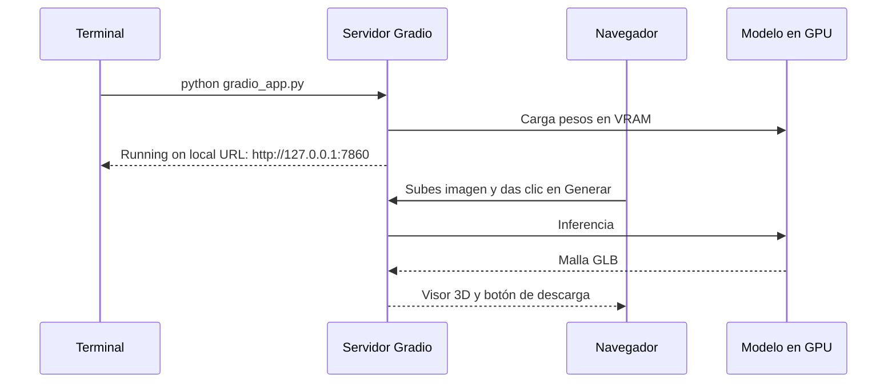

# Interfaces Gradio de los modelos 3D

Parte de: [[39-IA-Modelado-3D/02 Entorno local/_Índice Entorno local|Entorno local]]

> [!info] Cómo avanzar
> `progreso`: **pendiente** → **viendo** (estudiando) → **visto** (contestaste la autoevaluación sin abrir las respuestas) → **dominado** (hiciste el laboratorio o lo aplicaste de verdad).

## Contenido

### Qué es
**Gradio** es una biblioteca de Python que convierte una función (por ejemplo "imagen → malla") en una **página web local** con botones, controles deslizantes y un visor 3D. Casi todos los repos de IA 3D traen un archivo `gradio_app.py` para probar el modelo sin escribir código, y los **Spaces de Hugging Face** son exactamente eso mismo, pero corriendo en servidores de Hugging Face.

### Cómo funciona

1. Lanzas el script desde la terminal (con el `.venv` activado).
2. Gradio carga el modelo **una sola vez** en la VRAM y levanta un servidor web.
3. La consola imprime la dirección; Gradio usa el puerto **7860** por defecto, pero cada app puede cambiarlo (WinPortable de Hunyuan3D usa **8080**).
4. Abres la dirección en el navegador, subes la imagen, ajustas parámetros y descargas el GLB.
5. Para detener todo, cierras la consola o presionas `Ctrl+C`; mientras siga abierta, el modelo **sigue ocupando VRAM**.

### Ejemplo: TripoSR y Hunyuan3D-2mini
```powershell
# TripoSR
cd C:\IA3D\TripoSR
..\.venv\Scripts\Activate.ps1
python gradio_app.py
# -> abre http://127.0.0.1:7860

# Hunyuan3D-2mini, interfaz oficial en modo de poca VRAM (del README)
python gradio_app.py --model_path tencent/Hunyuan3D-2mini --subfolder hunyuan3d-dit-v2-mini --texgen_model_path tencent/Hunyuan3D-2 --low_vram_mode
```
Si la consola dice `Running on local URL: http://0.0.0.0:8080`, abre `http://localhost:8080/` en el navegador (0.0.0.0 significa "todas las interfaces", no es una dirección que el navegador abra bien).

### Gradio o línea de comandos
| Situación | Mejor opción |
|---|---|
| Probar una imagen y ver el modelo girando | Gradio |
| Ajustar a mano pasos, resolución, semilla | Gradio |
| Procesar 12 imágenes con los mismos parámetros | Script (`run.py`) |
| Medir tiempo y VRAM de forma reproducible | Script |
| Documentar exactamente qué corriste | Script (guardas el comando) |

```powershell
# TripoSR por lotes con los mismos parámetros, ideal para comparar
python run.py fotos\buho.png fotos\gato.png fotos\taza.png --output-dir out\ --model-save-format glb --mc-resolution 256
```
Para el [[Lab 3 - Hunyuan3D-2mini en poca VRAM vs TripoSR]] conviene el script: mismas imágenes, mismos parámetros y tiempos comparables.

### Seguridad y red
- Por defecto el servidor escucha solo en tu PC. Si una app usa `--share` o `0.0.0.0`, otras máquinas de tu red (o de internet, con `share=True`) podrían usarla. No lo actives si no lo necesitas.
- Gradio guarda en carpetas temporales las imágenes que subes y las mallas generadas; bórralas si son privadas.

### Cuándo usarlo y cuándo no
- **Úsalo** para explorar un modelo nuevo o enseñárselo a alguien.
- **No** para producción en lote ni para comparar modelos con rigor.
- Si quieres encadenar varias etapas (SD → quitar fondo → 3D) en un flujo guardado, mira [[ComfyUI para generación 3D]].

### Errores comunes
1. **Abrir `0.0.0.0` en el navegador.** Usa `localhost` o `127.0.0.1` con el puerto que diga la consola.
2. **Dejar la consola abierta y lanzar otro modelo.** El primero sigue en la VRAM y el segundo da OOM. Cierra antes.
3. **Puerto ocupado.** Si 7860 ya está en uso, Gradio prueba otro o falla; lee la consola para ver cuál tomó.
4. **Cambiar muchos controles a la vez.** No sabrás cuál mejoró el resultado; anota y cambia uno por vez.

### Para profundizar
- [Guía de inicio de Gradio](https://gradio.app/guides/quickstart)
- [TripoSR en GitHub](https://github.com/VAST-AI-Research/TripoSR)
- [Hunyuan3D-2 en GitHub](https://github.com/Tencent/Hunyuan3D-2)

## Autoevaluación

Contesta primero en voz alta o en papel; luego despliega la respuesta.

> [!question]- ¿Qué es Gradio en estos repos?
> Una biblioteca de Python que crea una página web local para el modelo. TripoSR la abre con `python gradio_app.py`; Hunyuan3D-2 también usa `gradio_app.py` con banderas como `--low_vram_mode`. Es lo mismo que ves en los Spaces de Hugging Face.

> [!question]- ¿Cuándo usarías la interfaz Gradio y cuándo el script de línea de comandos?
> Gradio para probar parámetros a mano y ver el modelo en 3D. El script (`run.py`) para procesar varias imágenes, repetir con los mismos parámetros y medir tiempo/VRAM de forma reproducible.

> [!question]- Caso: la consola dice que corre en el puerto 8080. ¿Qué haces?
> Abre `http://localhost:8080/` en el navegador (el puerto depende de la app: Gradio usa 7860 por defecto y WinPortable de Hunyuan3D usa 8080). Cierra la consola para detener el servidor.

## Práctica

- [[Lab 2 - Primer modelo con TripoSR desde una foto propia]]

