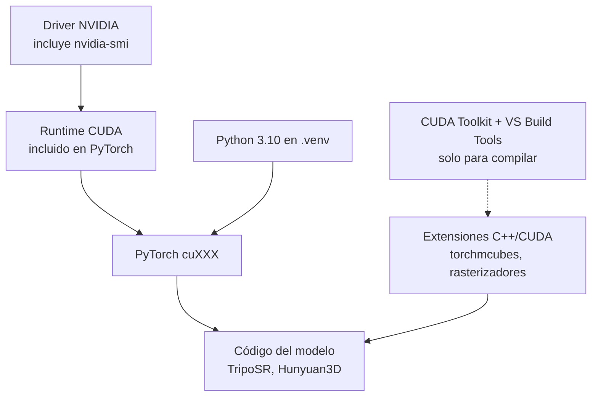

# Python, CUDA y PyTorch para IA 3D en Windows

Parte de: [[39-IA-Modelado-3D/02 Entorno local/_Índice Entorno local|Entorno local]]

> [!info] Cómo avanzar
> `progreso`: **pendiente** → **viendo** (estudiando) → **visto** (contestaste la autoevaluación sin abrir las respuestas) → **dominado** (hiciste el laboratorio o lo aplicaste de verdad).

## Contenido

### Qué es
Es la "pila" de software que necesitan casi todos los modelos de IA 3D para usar tu GPU NVIDIA en Windows. Python ejecuta el código del repo, **PyTorch** hace las operaciones de la red neuronal y **CUDA** es la plataforma de NVIDIA que permite a PyTorch hablar con la GTX 1660 Ti. Si una pieza no coincide con las demás, el modelo corre en CPU (lentísimo) o no compila. Esta nota es la base del [[Lab 1 - Preparar Python, CUDA y PyTorch y verificar la GPU]].

### Cómo funciona: las piezas

1. **Driver NVIDIA.** Lo instalas desde NVIDIA. Trae `nvidia-smi`. El "CUDA Version" que muestra `nvidia-smi` es la **versión máxima** de CUDA que ese driver soporta, no algo que tengas instalado.
2. **Python en un entorno virtual.** Cada repo pide versiones fijas de paquetes; un `.venv` por proyecto evita que se pisen ([[Python - entornos virtuales y pip]]). Python 3.10 es una elección conservadora (Hunyuan3D-2GP la pide).
3. **PyTorch con CUDA.** Las ruedas de PyTorch para GPU **ya incluyen** sus bibliotecas de CUDA; no necesitas el Toolkit solo para usarlo. Se instalan desde el índice de PyTorch, no desde PyPI a secas: en Windows, `pip install torch` sin índice te da la versión **solo CPU**.
4. **CUDA Toolkit y Visual Studio Build Tools** (carga *Desarrollo para el escritorio con C++*): solo si el repo **compila** extensiones, como `torchmcubes` de TripoSR o los rasterizadores de textura de Hunyuan3D.

### Ejemplo: instalación y verificación en PowerShell
```powershell
# 1) Driver: anota "CUDA Version" (máximo soportado por el driver)
nvidia-smi

# 2) Entorno con Python 3.10 usando el lanzador py
mkdir C:\IA3D; cd C:\IA3D
py -3.10 -m venv .venv
.venv\Scripts\Activate.ps1      # si lo bloquea: Set-ExecutionPolicy -Scope CurrentUser RemoteSigned
python --version

# 3) PyTorch para una versión de CUDA <= la que mostró nvidia-smi (aquí, ejemplo con cu126)
pip install torch torchvision --index-url https://download.pytorch.org/whl/cu126

# 4) Verificación en una línea
python -c "import torch; print(torch.__version__, torch.version.cuda, torch.cuda.is_available(), torch.cuda.get_device_name(0))"

# 5) Arquitectura de la GPU
python -c "import torch; print(torch.cuda.get_device_capability(0))"
```
Lo esperado en tu PC: algo como `2.x.x+cu126 12.6 True NVIDIA GeForce GTX 1660 Ti` y `(7, 5)`. La versión exacta de PyTorch y de CUDA que ofrezca el selector de pytorch.org cambia con el tiempo: usa el comando que te dé el selector ese día.

**Compute capability (7, 5)** significa arquitectura **Turing**, la de las GTX 16 y RTX 20. Las GTX 16 **no tienen Tensor Cores** y tienen problemas conocidos con FP16 ([[Tarjetas GTX 16 y media precisión (FP16)]]). Bibliotecas que exigen Ampere (8.0) o más nuevas, como FlashAttention 2, no aplican a tu tarjeta (Pendiente de confirmar para cada versión).

### Si el driver es más viejo que el PyTorch que quieres
Si `nvidia-smi` dice `CUDA Version: 12.6` y quieres PyTorch para CUDA 12.8 (cu128), el driver no garantiza esa versión y la GPU puede no inicializar. Dos salidas: **actualizar el driver** (lo más simple) o instalar la variante **cu126**. La regla: CUDA de PyTorch **igual o menor** a lo que dice `nvidia-smi`.

### Por qué TripoSR insiste en que coincida la versión mayor de CUDA
`torchmcubes` se compila en tu PC contra el **CUDA Toolkit local**. Si el Toolkit es 11.x y PyTorch es 12.x (versión mayor distinta), la compilación sale **sin soporte CUDA** y al correr verás `torchmcubes was not compiled with CUDA support`. Instala un Toolkit de la misma versión mayor que `torch.version.cuda` y reinstala `torchmcubes` ([[TripoSR]]).

### Cuándo usarlo y cuándo no
- **Instalación manual** (esta nota) cuando quieres entender y controlar el entorno, o el repo no tiene paquete portable.
- **Paquetes portables** (como Hunyuan3D-2-WinPortable) cuando solo quieres usar el modelo: traen Python y dependencias listas.
- **ComfyUI portable** si vas a encadenar SD y 3D con nodos ([[ComfyUI para generación 3D]]).

### Errores comunes
1. **`torch.cuda.is_available()` da `False`.** Revisa `torch.__version__`: si termina en `+cpu`, desinstala y reinstala con `--index-url`. Confirma que estás en el `.venv` correcto (`where python`) y que `nvidia-smi` funciona.
2. **Instalar el Toolkit "por si acaso" con otra versión mayor.** Rompe compilaciones; instálalo solo si compilas, y de la versión mayor correcta.
3. **Mezclar entornos.** Instalar dos repos en el mismo `.venv` termina en conflictos de versiones. Uno por proyecto.
4. **Olvidar Visual Studio Build Tools.** Sin el compilador de C++, `pip install` de extensiones falla con errores de `cl.exe`.

### Para profundizar
- [Selector de instalación de PyTorch](https://pytorch.org/get-started/locally/)
- [README de TripoSR (sección de solución de problemas)](https://github.com/VAST-AI-Research/TripoSR)
- [torchmcubes en GitHub](https://github.com/tatsy/torchmcubes)

## Ejercicios

Resuélvelos en papel o en la herramienta; la solución está plegada.

> [!question]- Escribe un comando de una línea que imprima versión de PyTorch, versión de CUDA de PyTorch, si hay GPU y su nombre.
> ```
> python -c "import torch; print(torch.__version__, torch.version.cuda, torch.cuda.is_available(), torch.cuda.get_device_name(0))"
> ```
> En tu equipo debe mostrar algo como `2.x.x+cu12x 12.x True NVIDIA GeForce GTX 1660 Ti`. Si sale `+cpu ... None False`, reinstala PyTorch con el índice de CUDA (y `get_device_name` dará error porque no hay GPU visible).

> [!question]- Ejecutas `torch.cuda.get_device_capability(0)` y obtienes `(7, 5)`. ¿Qué te dice?
> Compute capability 7.5 = arquitectura **Turing** (GTX 16 y RTX 20). Las GTX 16 no tienen Tensor Cores y tienen problemas conocidos con FP16 ([[Tarjetas GTX 16 y media precisión (FP16)]]). Bibliotecas que exigen Ampere (8.0) o más nuevas, como FlashAttention 2, no aplican a tu tarjeta (Pendiente de confirmar para cada versión).

> [!question]- `nvidia-smi` muestra `CUDA Version: 12.6` y quieres instalar PyTorch para CUDA 12.8. ¿Qué pasa y qué haces?
> El driver solo garantiza hasta 12.6, así que PyTorch cu128 puede no inicializar la GPU. Opciones: actualizar el driver NVIDIA o instalar la variante de PyTorch para CUDA 12.6 (cu126).

> [!question]- En PowerShell, ¿cómo creas y activas un entorno con Python 3.10 si tienes el lanzador `py`?
> ```
> py -3.10 -m venv .venv
> .venv\Scripts\Activate.ps1
> python --version
> ```
> Si PowerShell bloquea el script, ejecuta una vez `Set-ExecutionPolicy -Scope CurrentUser RemoteSigned`. Python 3.10 es una elección conservadora para estos repos (Hunyuan3D-2GP la pide); revisa el README de cada uno.

## Autoevaluación

Contesta primero en voz alta o en papel; luego despliega la respuesta.

> [!question]- ¿Qué piezas necesitas y qué hace cada una?
> 1) **Driver NVIDIA** (incluye `nvidia-smi`). 2) **Python** en un entorno virtual ([[Python - entornos virtuales y pip]]). 3) **PyTorch con CUDA** (trae sus propias bibliotecas de CUDA). 4) Solo si vas a **compilar** extensiones (torchmcubes, rasterizadores de Hunyuan3D): **CUDA Toolkit** y **Visual Studio Build Tools** con *Desarrollo para el escritorio con C++*.

> [!question]- ¿Cómo instalas PyTorch con soporte de GPU?
> Usa el selector de [pytorch.org](https://pytorch.org/get-started/locally/) (Windows, Pip, la versión de CUDA). El comando tiene la forma
> ```
> pip install torch torchvision --index-url https://download.pytorch.org/whl/cuXXX
> ```
> donde `cuXXX` es la versión de CUDA sin punto. Si instalas `pip install torch` a secas desde PyPI en Windows obtienes la versión **solo CPU**.

> [!question]- ¿Qué significa el "CUDA Version" que muestra `nvidia-smi`?
> Es la versión **máxima** de CUDA que soporta tu driver, no la que tienes instalada. PyTorch con CUDA igual o menor funciona; si necesitas una más nueva, actualiza el driver.

> [!question]- Error común: `torch.cuda.is_available()` devuelve `False`. ¿Qué revisas?
> 1) `print(torch.__version__)`: si termina en `+cpu` instalaste la versión CPU; desinstala y reinstala con `--index-url`. 2) Que estés en el entorno virtual correcto (`where python`). 3) Que `nvidia-smi` funcione (driver bien instalado).

> [!question]- ¿Por qué TripoSR insiste en que coincida la versión mayor de CUDA?
> Porque `torchmcubes` se compila contra el CUDA Toolkit local; si su versión mayor no coincide con la de PyTorch, se compila sin CUDA y falla con `torchmcubes was not compiled with CUDA support` ([README de TripoSR](https://github.com/VAST-AI-Research/TripoSR)).

## Práctica

- [[Lab 1 - Preparar Python, CUDA y PyTorch y verificar la GPU]]

