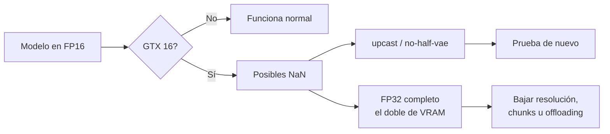

# Tarjetas GTX 16 y media precisión (FP16)

Parte de: [[39-IA-Modelado-3D/02 Entorno local/_Índice Entorno local|Entorno local]]

> [!info] Cómo avanzar
> `progreso`: **pendiente** → **viendo** (estudiando) → **visto** (contestaste la autoevaluación sin abrir las respuestas) → **dominado** (hiciste el laboratorio o lo aplicaste de verdad).

## Contenido

### Qué es
La **media precisión (FP16)** guarda cada número en 16 bits en lugar de 32 (FP32). Ahorra la mitad de memoria y en muchas GPU es más rápida, por eso casi todos los modelos de IA la usan por defecto. Las tarjetas **GTX 16** (1630, 1650, 1660, 1660 Super, **1660 Ti**) son una excepción conocida: con ciertos modelos y versiones de bibliotecas, la inferencia en FP16 produce **NaN** (valores "no es un número"), que se ven como imágenes negras o verdes en Stable Diffusion, o mallas vacías en modelos 3D.

### Cómo funciona el problema
- Las GTX 16 son arquitectura **Turing** (compute capability 7.5) pero, a diferencia de las RTX 20, **no tienen Tensor Cores**.
- FP16 tiene un rango pequeño: valores mayores a ~65,504 se desbordan a infinito, y una operación con infinito termina en NaN. Un solo NaN se propaga por toda la red.
- En estas tarjetas, ciertas combinaciones de cuDNN y operaciones (convoluciones, atención) dan resultados erróneos en FP16. Un mantenedor de PyTorch lo reprodujo en una 1660 Ti en el [issue #58123](https://github.com/pytorch/pytorch/issues/58123); se corrigió en cuDNN 8.2.2, pero usuarios reportaron que volvió en versiones posteriores.
- Por eso **ComfyUI** desactiva FP16 por defecto en tarjetas cuyo nombre contiene "1660", "1650" o "1630".



### Ejemplo: Stable Diffusion WebUI (AUTOMATIC1111)
La [guía de problemas de AUTOMATIC1111](https://github.com/AUTOMATIC1111/stable-diffusion-webui/wiki/Troubleshooting) recomienda para tarjetas 16XX y 10XX:
```bat
rem webui-user.bat - empieza por aquí
set COMMANDLINE_ARGS=--upcast-sampling --xformers

rem Si siguen saliendo imágenes negras o verdes, agrega:
set COMMANDLINE_ARGS=--upcast-sampling --xformers --no-half-vae

rem Último recurso: todo en FP32 (mucha más VRAM)
set COMMANDLINE_ARGS=--precision full --no-half --medvram
```
`--upcast-sampling` hace las operaciones delicadas en FP32 y el resto en FP16; `--no-half-vae` deja solo el VAE (el decodificador de imagen) en FP32; `--precision full --no-half` pasa todo a FP32.

En **ComfyUI** no tienes que hacer nada para evitar FP16; si te falta memoria, arranca con `--lowvram` ([[ComfyUI para generación 3D]]).

### Qué implica usar FP32 en 6 GB
Pesos y activaciones ocupan **el doble**. Un modelo que en FP16 necesitaba 4.5 GB en total puede pedir cerca de 9 GB en FP32: ya no cabe. Compensa con:
- Resolución más baja (512×512 en SD 1.5, `--mc-resolution` 256 en TripoSR).
- *Chunks* más pequeños.
- *Offloading* a RAM (más lento).
Ver [[VRAM - medirla y qué hacer cuando no alcanza]].

### Caso: Hunyuan3D-2mini da malla vacía o NaN en tu 1660 Ti
1. **Descarta memoria:** revisa si hubo `CUDA out of memory` en la consola; si sí, es otro problema.
2. **Prueba un paquete optimizado:** [Hunyuan3D-2-WinPortable](https://github.com/YanWenKun/Hunyuan3D-2-WinPortable) o [Hunyuan3D-2GP](https://github.com/deepbeepmeep/Hunyuan3D-2GP), pensados para tarjetas de consumo.
3. **Fuerza FP32** si el código permite elegir `dtype` (por ejemplo, al cargar el pipeline). Mide VRAM después.
4. **Compara con TripoSR** usando la misma imagen: si TripoSR funciona, el problema es del modelo/precisión, no de tu entorno.
Que Hunyuan3D-2mini funcione bien en FP16 en GTX 16: (Pendiente de confirmar). Anota tu resultado en el [[Lab 3 - Hunyuan3D-2mini en poca VRAM vs TripoSR]].

### Cuándo usarlo y cuándo no
- **Intenta FP16 primero** si el modelo lo usa por defecto y funciona: ahorra memoria.
- **Pasa a upcast o FP32** en cuanto veas negro, verde, NaN o mallas vacías.
- **No** culpes a la GPU de todo: un fondo sucio o un modelo mal descargado también dan resultados vacíos.

### Errores comunes
1. **Arrancar directo con `--precision full --no-half`.** Gastas el doble de VRAM sin necesidad; empieza con `--upcast-sampling`.
2. **Confundir NaN con falta de memoria.** El OOM da un error explícito; el NaN da resultados vacíos sin error.
3. **Seguir guías hechas para RTX.** Muchos tutoriales asumen Tensor Cores y FP16 estable.
4. **Instalar FlashAttention o xformers para otra arquitectura.** Revisa que la versión soporte compute capability 7.5.

### Para profundizar
- [Issue #58123 de PyTorch (NaN en GTX 1660 Ti)](https://github.com/pytorch/pytorch/issues/58123)
- [Guía de problemas de AUTOMATIC1111](https://github.com/AUTOMATIC1111/stable-diffusion-webui/wiki/Troubleshooting)
- [ComfyUI en GitHub](https://github.com/Comfy-Org/ComfyUI)

## Autoevaluación

Contesta primero en voz alta o en papel; luego despliega la respuesta.

> [!question]- ¿Cuál es el problema conocido de las GTX 16 con FP16?
> En algunos modelos la inferencia en FP16 da **NaN** (imágenes negras o verdes, mallas vacías). Un mantenedor de PyTorch lo reprodujo en una 1660 Ti en el [issue #58123](https://github.com/pytorch/pytorch/issues/58123); se corrigió en cuDNN 8.2.2, pero usuarios reportaron que volvió con versiones posteriores. ComfyUI desactiva FP16 por defecto en tarjetas cuyo nombre contiene "1660", "1650" o "1630", con el comentario de que FP16 no funciona bien en ellas.

> [!question]- ¿Qué banderas usa Stable Diffusion WebUI (AUTOMATIC1111) para estas tarjetas?
> Su [guía de problemas](https://github.com/AUTOMATIC1111/stable-diffusion-webui/wiki/Troubleshooting) recomienda para 16XX y 10XX `--upcast-sampling` (con `--xformers`). Si sigue la imagen negra o verde: `--no-half-vae`; como último recurso `--precision full --no-half`, que usa mucha más VRAM y puede requerir `--medvram`.

> [!question]- ¿Qué implica usar FP32 en vez de FP16 en 6 GB?
> Los pesos y activaciones ocupan el **doble**, así que algo que cabía justo en FP16 puede ya no caber. Compensa bajando resolución, *chunks* o usando *offloading*.

> [!question]- Caso: Hunyuan3D-2mini te da una malla vacía o un error de NaN en tu 1660 Ti. ¿Qué pruebas?
> Primero confirma que no es falta de memoria. Luego prueba el paquete [WinPortable](https://github.com/YanWenKun/Hunyuan3D-2-WinPortable) o [Hunyuan3D-2GP](https://github.com/deepbeepmeep/Hunyuan3D-2GP), que tienen optimizaciones para tarjetas de consumo. Si el código permite elegir tipo de dato, prueba FP32. Que Hunyuan3D-2mini funcione bien en FP16 en GTX 16: (Pendiente de confirmar).

## Práctica

- [[Lab 1 - Preparar Python, CUDA y PyTorch y verificar la GPU]]
- [[Lab 3 - Hunyuan3D-2mini en poca VRAM vs TripoSR]]

