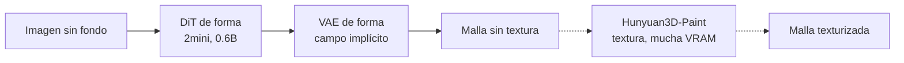

# Hunyuan3D-2mini

Parte de: [[39-IA-Modelado-3D/03 Modelos/_Índice Modelos|Modelos]]

> [!info] Cómo avanzar
> `progreso`: **pendiente** → **viendo** (estudiando) → **visto** (contestaste la autoevaluación sin abrir las respuestas) → **dominado** (hiciste el laboratorio o lo aplicaste de verdad).

## Contenido

### Qué es
**Hunyuan3D-2mini** es la versión pequeña del generador de **forma** de Tencent Hunyuan3D 2.0: **0.6 mil millones de parámetros**, frente a 1.1 mil millones del modelo de forma original. Es un modelo de **difusión**: parte de ruido en un espacio latente de formas y lo limpia en varios pasos guiado por tu imagen, lo que da formas más definidas que la reconstrucción directa de TripoSR. Tiene variantes **mini**, **mini-Fast** (destilación de la guía) y **mini-Turbo** (destilación de pasos, menos pasos con calidad parecida). La **textura** la hace otro modelo, Hunyuan3D-Paint.

### Cómo funciona

- **Forma (DiT + VAE):** genera latentes que se decodifican a un campo tipo ocupación y se extrae la malla ([[Campos implícitos (SDF y ocupación)]]).
- **Textura (Paint):** pinta la malla con varias vistas; es la etapa que más memoria pide.

### Cuánta VRAM pide y qué esperar en 6 GB
- El README oficial de Hunyuan3D-2 indica **6 GB para forma** y **16 GB para forma más textura**.
- En tu GTX 1660 Ti lo realista es **solo forma**, con `--low_vram_mode`. El color lo pones después en el laminador.
- El paquete [Hunyuan3D-2-WinPortable](https://github.com/YanWenKun/Hunyuan3D-2-WinPortable), que integra las optimizaciones *mmgp* de Hunyuan3D-2GP, indica mínimo 3 GB para geometría con el modelo 2.1 y 6 GB para textura con máxima optimización, pero pide **24 GB de RAM o más**. Que la textura funcione en tu 1660 Ti: (Pendiente de confirmar).
- Para referencia, **Hunyuan3D 2.1** (la versión siguiente) pide unos 10 GB para forma, 21 GB para textura y 29 GB en total según su README: no es para tu tarjeta salvo con esos paquetes optimizados.

### Ejemplo: tres formas de correrlo en Windows
**1) Interfaz oficial (repo Hunyuan3D-2):**
```powershell
python gradio_app.py --model_path tencent/Hunyuan3D-2mini --subfolder hunyuan3d-dit-v2-mini --texgen_model_path tencent/Hunyuan3D-2 --low_vram_mode
# Variante Turbo (menos pasos):
python gradio_app.py --model_path tencent/Hunyuan3D-2mini --subfolder hunyuan3d-dit-v2-mini-turbo --texgen_model_path tencent/Hunyuan3D-2 --low_vram_mode --enable_flashvdm
```
Requiere compilar extensiones (CUDA Toolkit y VS Build Tools) para la parte de textura.

**2) [Hunyuan3D-2-WinPortable](https://github.com/YanWenKun/Hunyuan3D-2-WinPortable):** descomprimes, corres `UPDATE.bat` y luego `RUN.bat`, y abres `http://localhost:8080/`. Para Turing (GTX 1660 Ti) sirven los paquetes CUDA 12.9 o 12.6; requiere driver 576.57 o más nuevo.

**3) [Hunyuan3D-2GP](https://github.com/deepbeepmeep/Hunyuan3D-2GP):** `python gradio_app.py` lanza el mini; para 6–9 GB de VRAM usa `--profile 4`.

En cualquiera: genera **solo forma**, mide VRAM y tiempo, y compara con TripoSR usando las mismas imágenes ([[Lab 3 - Hunyuan3D-2mini en poca VRAM vs TripoSR]]). Si aparece una malla vacía o NaN, revisa [[Tarjetas GTX 16 y media precisión (FP16)]].

### ¿Puedes usarlo en México y vender impresiones?
Sí, con condiciones. La [licencia Tencent Hunyuan 3D Community](https://huggingface.co/tencent/Hunyuan3D-2/blob/main/LICENSE) excluye del territorio solo a la **Unión Europea, Reino Unido y Corea del Sur**; México está dentro. Permite uso comercial salvo que tus productos o servicios superen **1 millón de usuarios activos mensuales**, y Tencent no reclama derechos sobre lo que generas. Debes respetar su política de uso aceptable. Detalle en [[Licencia Tencent Hunyuan 3D Community]].

### Cuándo usarlo y cuándo no
- **Úsalo** cuando TripoSR te dé formas blandas o poco definidas y la pieza lo amerite.
- **Usa Turbo** para iterar; mini normal para la versión final.
- **No** intentes la textura en 6 GB como flujo normal; si la necesitas, usa un Space ([[Modelos de imagen a 3D en la nube gratuita (Hugging Face y Colab)]]).

### Errores comunes
1. **Lanzar sin `--low_vram_mode`.** En 6 GB es casi seguro el OOM.
2. **Suponer que el mini incluye textura.** La textura es otro modelo y pide mucho más.
3. **Descargar pesos de forks no oficiales.** Usa la [tarjeta oficial](https://huggingface.co/tencent/Hunyuan3D-2mini).
4. **Olvidar la RAM.** Los modos de poca VRAM mueven pesos a la RAM; con poca RAM todo se vuelve lentísimo.

### Para profundizar
- [Hunyuan3D-2 en GitHub (README con requisitos)](https://github.com/Tencent/Hunyuan3D-2)
- [Tarjeta de Hunyuan3D-2mini](https://huggingface.co/tencent/Hunyuan3D-2mini)
- [Licencia Tencent Hunyuan 3D Community](https://huggingface.co/tencent/Hunyuan3D-2/blob/main/LICENSE)
- [README de Hunyuan3D 2.1 (requisitos de VRAM)](https://huggingface.co/spaces/tencent/Hunyuan3D-2.1/blame/refs%2Fpr%2F15/README.md)

## Autoevaluación

Contesta primero en voz alta o en papel; luego despliega la respuesta.

> [!question]- ¿Qué es Hunyuan3D-2mini?
> La versión pequeña del generador de **forma** de Tencent Hunyuan3D 2.0: **0.6 mil millones de parámetros** (frente a 1.1 mil millones del original), con variantes *mini*, *mini-Fast* (destilación de guía) y *mini-Turbo* (destilación de pasos) ([README](https://github.com/Tencent/Hunyuan3D-2), [tarjeta del modelo](https://huggingface.co/tencent/Hunyuan3D-2mini)). La textura se genera con otro modelo (Hunyuan3D-Paint).

> [!question]- ¿Cuánta VRAM pide y qué puedes esperar en 6 GB?
> El README oficial dice **6 GB para forma** y **16 GB para forma y textura** en total. En 6 GB lo realista es **solo forma** con `--low_vram_mode`. El paquete [WinPortable](https://github.com/YanWenKun/Hunyuan3D-2-WinPortable) (que integra las optimizaciones *mmgp* de Hunyuan3D-2GP) indica mínimo 3 GB para geometría con el modelo 2.1 y 6 GB para textura con máxima optimización, pero pide ≥ 24 GB de RAM. Que la textura funcione en tu 1660 Ti: (Pendiente de confirmar).

> [!question]- ¿Cómo lanzas la interfaz oficial con el modelo mini en modo de poca VRAM?
> Del README:
> ```
> python gradio_app.py --model_path tencent/Hunyuan3D-2mini --subfolder hunyuan3d-dit-v2-mini --texgen_model_path tencent/Hunyuan3D-2 --low_vram_mode
> ```
> Para la variante Turbo usa `--subfolder hunyuan3d-dit-v2-mini-turbo` y agrega `--enable_flashvdm`.

> [!question]- ¿Qué opciones fáciles hay en Windows?
> 1) [Hunyuan3D-2-WinPortable](https://github.com/YanWenKun/Hunyuan3D-2-WinPortable): descomprimes, corres `UPDATE.bat` y `RUN.bat`, y abres `http://localhost:8080/`. Para la GTX 1660 Ti (Turing) sirven los paquetes CUDA 12.9 o 12.6; requiere driver 576.57 o más nuevo. 2) [Hunyuan3D-2GP](https://github.com/deepbeepmeep/Hunyuan3D-2GP): `python gradio_app.py` lanza el mini; para 6–9 GB de VRAM usa `--profile 4`.

> [!question]- ¿Puedes usarlo en México y para vender impresiones?
> La [licencia](https://huggingface.co/tencent/Hunyuan3D-2/blob/main/LICENSE) excluye solo la **Unión Europea, Reino Unido y Corea del Sur**, así que México está dentro del territorio. Permite uso comercial salvo que tus productos superen 1 millón de usuarios activos mensuales; Tencent no reclama derechos sobre los resultados. Ver [[Licencia Tencent Hunyuan 3D Community]].

## Práctica

- [[Lab 3 - Hunyuan3D-2mini en poca VRAM vs TripoSR]]

