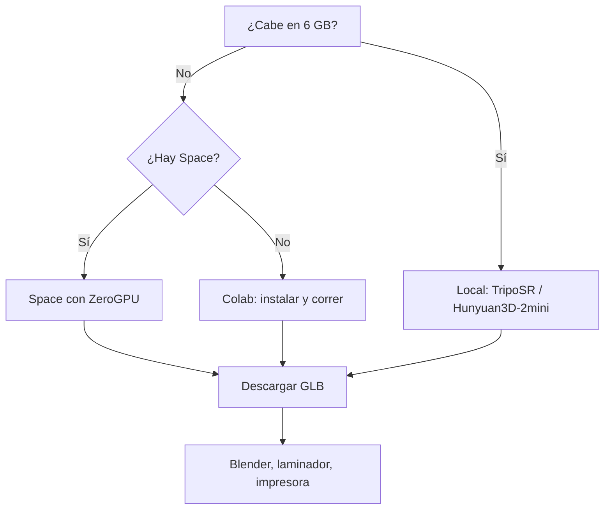

# Modelos de imagen a 3D en la nube gratuita (Hugging Face y Colab)

Parte de: [[39-IA-Modelado-3D/03 Modelos/_Índice Modelos|Modelos]]

> [!info] Cómo avanzar
> `progreso`: **pendiente** → **viendo** (estudiando) → **visto** (contestaste la autoevaluación sin abrir las respuestas) → **dominado** (hiciste el laboratorio o lo aplicaste de verdad).

## Contenido

### Qué es
Cuando un modelo no cabe en tus 6 GB de VRAM, puedes correrlo gratis (con límites) en la nube. Las dos opciones principales son los **Spaces de Hugging Face**, demos web listas para usar, y **Google Colab**, cuadernos de Python con GPU temporal donde tú instalas el modelo. Ambos te permiten usar TRELLIS, TRELLIS.2 o Hunyuan3D con textura, y descargar el GLB para terminarlo en tu PC.

### Cómo funciona
**Spaces de Hugging Face.** Un Space es una app (casi siempre Gradio) que corre en la infraestructura de Hugging Face. Muchos usan **ZeroGPU**, que asigna GPU por petición y descuenta de una **cuota diaria** por cuenta. Según la [documentación de ZeroGPU](https://huggingface.co/docs/hub/spaces-zerogpu) (consultada 2026-11-10):

| Tipo de cuenta | Cuota diaria de GPU | Prioridad en fila |
|---|---|---|
| Sin iniciar sesión | 2 minutos | Baja |
| Cuenta gratuita | 5 minutos | Media |
| PRO | 40 minutos (ampliable) | Alta |

La cuota se reinicia **24 horas después de tu primer uso**, no a una hora fija. El hardware de ZeroGPU es una fracción de una NVIDIA RTX Pro 6000 Blackwell con 48 GB (o la tarjeta completa con 96 GB a doble costo de cuota). Estos números cambian: revísalos cuando planees una sesión larga.

**Google Colab.** Abres un cuaderno, eliges un entorno con GPU y ejecutas celdas que clonan el repo, instalan dependencias y corren el modelo. En el plan gratuito Google **no garantiza** qué GPU te toca ni publica una cuota fija; las sesiones duran como máximo 12 horas y pueden cortarse antes por inactividad o demanda ([FAQ de Colab](https://research.google.com/colaboratory/faq.html)). Comprueba con `!nvidia-smi` qué GPU y cuánta memoria te asignaron. Cada sesión empieza desde cero: hay que reinstalar todo. Ver [[Google Colab]].

### Ejemplo: cuánto rinde la cuota gratuita
Un Space tarda unos 40 s de GPU por modelo y tu cuenta gratuita tiene 5 minutos diarios: 300 s ÷ 40 s = 7.5, o sea **7 modelos** al día. Estrategia: valida las imágenes en local con TripoSR (gratis e ilimitado) y usa la nube solo para las 2 o 3 que de verdad necesitan el modelo grande. Si el Space tarda más por fila, la cuota no corre mientras esperas en fila, solo mientras usas GPU (Pendiente de confirmar para cada Space).

### Decidir local o nube
| Caso | Decisión | Por qué |
|---|---|---|
| Figura de 8 cm, fondo limpio, 5 variantes hoy | **Local** | Rápido, sin cuota; imprimirás en un color o pintarás en el laminador |
| Textura PBR detallada para comparar estilos | **Nube** | La textura pide 16 GB o más; tu GPU tiene 6 |
| Boceto de un producto que no es público | **Local** | No subas diseños confidenciales a terceros |
| Figura final con mucho detalle | **Nube** (TRELLIS.2) | Calidad de forma superior |

### Riesgos de privacidad y licencia
- **Privacidad:** subes tu imagen a un tercero; algunos Spaces guardan ejemplos o resultados en caché visible. No subas fotos de personas sin permiso ni diseños confidenciales.
- **Licencia:** la del **modelo** sigue aplicando aunque corra en la nube. Hunyuan3D sigue sujeto a su territorio (fuera de UE, Reino Unido y Corea del Sur) y a sus condiciones; TRELLIS es MIT ([[Licencias de modelos de IA 3D]]).
- **Términos del servicio:** Hugging Face y Google tienen sus propios términos de uso.

### Cuándo usarlo y cuándo no
- **Úsalo** para modelos que oficialmente piden 16–24 GB.
- **No** para iterar decenas de veces: la cuota se acaba rápido.
- **No** para material confidencial.

### Errores comunes
1. **Usar el Space sin iniciar sesión.** Tienes menos cuota y prioridad.
2. **Gastar cuota en imágenes mal preparadas.** Quita el fondo y prueba en local primero.
3. **Olvidar descargar el GLB.** El resultado puede desaparecer al cerrar la pestaña.
4. **Confiar en que Colab te dará la misma GPU siempre.** Revisa `!nvidia-smi` en cada sesión.

### Para profundizar
- [Documentación de ZeroGPU (Hugging Face)](https://huggingface.co/docs/hub/spaces-zerogpu)
- [Preguntas frecuentes de Google Colab](https://research.google.com/colaboratory/faq.html)
- [Space de TRELLIS.2](https://huggingface.co/spaces/microsoft/TRELLIS.2)

## Ejercicios

Resuélvelos en papel o en la herramienta; la solución está plegada.

> [!question]- Decide local o nube: figura decorativa de 8 cm, foto con fondo limpio, quieres probar 5 variantes hoy.
> **Local con TripoSR o Hunyuan3D-2mini (solo forma)**: son variantes rápidas, sin cuota, y la malla la vas a limpiar e imprimir en un color (o pintar en el laminador). No necesitas textura.

> [!question]- Decide local o nube: necesitas un modelo con textura PBR detallada para comparar estilos.
> **Nube** (Space de TRELLIS.2 o Hunyuan3D con textura): la textura pide ≥ 16 GB oficialmente y tu GPU tiene 6 GB. Descarga el GLB y termina en local.

> [!question]- Decide local o nube: la imagen es un boceto de un producto que aún no es público.
> **Local**: evita subir diseños confidenciales a un servicio de terceros, aunque la calidad sea menor.

> [!question]- Un Space tarda 40 s por modelo pero tu cuota diaria es de 5 min de GPU (supuesto). ¿Cuántos modelos puedes generar? ¿Qué harías con el resto?
> 300 s / 40 s = 7.5 → **7 modelos**. Usa la nube solo para las imágenes que de verdad necesitan el modelo grande y genera las demás en local.

## Autoevaluación

Contesta primero en voz alta o en papel; luego despliega la respuesta.

> [!question]- ¿Qué es un Space de Hugging Face y cuál es su límite principal?
> Una demo web (casi siempre Gradio) que corre en GPU de Hugging Face. Muchos usan **ZeroGPU**, que reparte GPU con una cuota diaria por usuario; cuando se acaba esperas o inicias sesión para tener más. Los límites exactos cambian (Pendiente de confirmar).

> [!question]- ¿Qué ofrece Google Colab gratis para esto?
> Un cuaderno con GPU por tiempo limitado (normalmente una GPU con más VRAM que la tuya; la disponibilidad no está garantizada en el plan gratuito). Sirve para correr modelos que piden 12–16 GB, pero tú instalas todo en cada sesión. Ver [[Google Colab]].

> [!question]- ¿Qué riesgo de privacidad y licencia tiene la nube?
> Subes tu imagen a un tercero y el resultado puede quedar en caché pública del Space. La licencia del **modelo** sigue aplicando aunque lo corras en la nube (p. ej. Hunyuan3D fuera de UE/RU/Corea del Sur).

## Práctica

- [[Lab 6 - Modelo pesado en la nube y acabado en local]]

