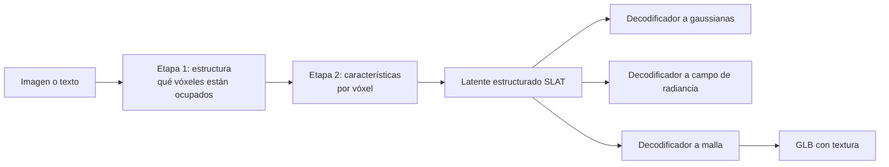

# TRELLIS

Parte de: [[39-IA-Modelado-3D/03 Modelos/_Índice Modelos|Modelos]]

> [!info] Cómo avanzar
> `progreso`: **pendiente** → **viendo** (estudiando) → **visto** (contestaste la autoevaluación sin abrir las respuestas) → **dominado** (hiciste el laboratorio o lo aplicaste de verdad).

## Contenido

### Qué es
**TRELLIS** es un modelo de Microsoft para generar 3D a partir de imagen o texto. Su idea central es una **representación latente estructurada** (SLAT): un conjunto de vóxeles activos con características, que luego se puede **decodificar** a distintos formatos: gaussianas 3D, campos de radiancia o malla GLB. Modelos y la mayor parte del código están bajo licencia **MIT** (algunos submódulos tienen su propia licencia). Su sucesor, **TRELLIS.2**, tiene unos 4 mil millones de parámetros, también MIT, y agrega materiales **PBR**.

### Cómo funciona

1. **Estructura gruesa:** primero genera qué celdas de una rejilla 3D tienen "algo" (la forma burda).
2. **Detalle:** luego genera características para cada celda ocupada.
3. **Decodificación:** el mismo latente se convierte en el formato que pidas. Para imprimir te interesa la **malla**, que la interfaz exporta en GLB con textura horneada.

Por eso es muy versátil y de alta calidad, pero pesado: dos etapas de generación más decodificadores.

### Hardware oficial
- **TRELLIS:** GPU NVIDIA con **al menos 16 GB**, probado solo en **Linux** (A100/A6000).
- **TRELLIS.2:** **al menos 24 GB**, solo Linux (A100/H100).

Ninguno promete funcionar en 6 GB. Con TRELLIS.2, solo los pesos en FP16 ocupan unos 7.5 GiB, más que toda tu VRAM ([[VRAM - medirla y qué hacer cuando no alcanza]]).

### ¿Hay formas de correrlo con menos VRAM?
Existen proyectos de la comunidad: instaladores para Windows de *stable-projectorz* (TRELLIS con optimizaciones en float16) y nodos de ComfyUI para TRELLIS.2 con modos `low_vram` que reportan 8 GB o incluso 6 GB. No son pruebas estandarizadas y en una GTX 16 se suma el problema de FP16 ([[Tarjetas GTX 16 y media precisión (FP16)]]). En tu GTX 1660 Ti considéralo **experimental**: (Pendiente de confirmar). La ruta segura es la nube.

### Ejemplo: calidad de TRELLIS sin GPU grande
1. Prepara la imagen en local: fondo quitado, objeto centrado, vista de tres cuartos ([[Crear la imagen de entrada para IA 3D]]).
2. Abre el [Space de TRELLIS](https://huggingface.co/spaces/microsoft/TRELLIS) o el de [TRELLIS.2](https://huggingface.co/spaces/microsoft/TRELLIS.2) e inicia sesión en Hugging Face (más cuota ZeroGPU que sin sesión).
3. Sube la imagen, genera, revisa el visor girándolo y **descarga el GLB** (no el `.ply` de gaussianas).
4. En Blender: importa, borra piezas sueltas, Voxel Remesh, base plana, escala a milímetros, revisa grosores y exporta STL o 3MF ([[Limpiar un modelo generado por IA en Blender]]).
5. Lamina en ElegooSlicer y, si quieres colores, píntalos con CANVAS ([[Separar un modelo por colores para CANVAS]]).
Es el [[Lab 6 - Modelo pesado en la nube y acabado en local]].

### Cuándo usarlo y cuándo no
- **Úsalo** para piezas finales donde la calidad de forma importa: figuras con muchos detalles, personajes originales.
- **Úsalo** como referencia para comparar tu flujo local.
- **No** lo uses para imágenes confidenciales (la nube es de un tercero) ni cuando la cuota ya se acabó: genera esas en local con TripoSR o Hunyuan3D-2mini.

### Errores comunes
1. **Descargar el `.ply` de gaussianas para imprimir.** Es apariencia, no sólido ([[Gaussian splatting en IA 3D]]). Baja el GLB.
2. **Gastar la cuota diaria en imágenes de prueba.** Valida la imagen primero en local con TripoSR.
3. **Intentar instalarlo en Windows con 6 GB "porque alguien dijo que sí".** Puedes perder días; si lo intentas, en una copia aparte y midiendo.
4. **Suponer que MIT cubre todo.** Revisa las licencias de submódulos y dependencias si redistribuyes código.

### Para profundizar
- [TRELLIS en GitHub](https://github.com/microsoft/TRELLIS)
- [TRELLIS.2 en GitHub](https://github.com/microsoft/TRELLIS.2)
- [Space de TRELLIS](https://huggingface.co/spaces/microsoft/TRELLIS)
- [Space de TRELLIS.2](https://huggingface.co/spaces/microsoft/TRELLIS.2)

## Autoevaluación

Contesta primero en voz alta o en papel; luego despliega la respuesta.

> [!question]- ¿Qué es TRELLIS y qué licencia tiene?
> Un modelo de Microsoft de imagen/texto a 3D que genera una representación latente estructurada y la decodifica a **gaussianas, campos de radiancia o malla GLB** ([repo](https://github.com/microsoft/TRELLIS)). Modelos y la mayor parte del código bajo **MIT** (algunos submódulos tienen su propia licencia). [TRELLIS.2](https://github.com/microsoft/TRELLIS.2) (4 mil millones de parámetros, MIT) agrega materiales PBR.

> [!question]- ¿Qué hardware pide oficialmente?
> TRELLIS: GPU NVIDIA de **al menos 16 GB**, probado solo en **Linux** (A100/A6000). TRELLIS.2: **al menos 24 GB**, solo Linux (A100/H100). Ninguno de los dos promete funcionar en 6 GB.

> [!question]- ¿Existen formas de correrlo con menos VRAM?
> Hay proyectos comunitarios: instaladores de Windows de *stable-projectorz* (TRELLIS con optimizaciones float16) y nodos de ComfyUI para TRELLIS.2 con modos `low_vram` que reportan 8 GB o incluso 6 GB, pero no son pruebas estandarizadas. En tu NVIDIA GTX 1660 Ti de 6 GB considéralo experimental: (Pendiente de confirmar). La ruta segura es el [Space de TRELLIS](https://huggingface.co/spaces/microsoft/TRELLIS) o el de [TRELLIS.2](https://huggingface.co/spaces/microsoft/TRELLIS.2).

> [!question]- Caso: quieres la calidad de TRELLIS para una figura. ¿Cómo lo haces sin GPU grande?
> Generas en el Space de Hugging Face, descargas el GLB y haces todo lo demás en local: limpieza en Blender, escala, laminado e impresión. Ver [[Lab 6 - Modelo pesado en la nube y acabado en local]].

## Práctica

- [[Lab 6 - Modelo pesado en la nube y acabado en local]]

