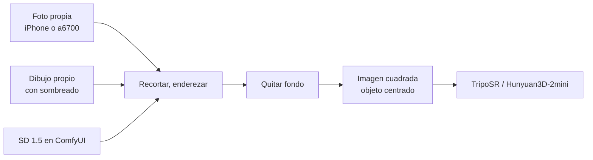

# Crear la imagen de entrada para IA 3D

Parte de: [[39-IA-Modelado-3D/04 Flujo completo/_Índice Flujo completo|Flujo completo]]

> [!info] Cómo avanzar
> `progreso`: **pendiente** → **viendo** (estudiando) → **visto** (contestaste la autoevaluación sin abrir las respuestas) → **dominado** (hiciste el laboratorio o lo aplicaste de verdad).

## Contenido

### Qué es
Es el primer paso del flujo y el que más influye en el resultado: preparar **una imagen de un solo objeto** que el modelo de imagen a 3D pueda "leer" bien. La IA solo puede reconstruir lo que ve (y adivinar el resto), así que una buena imagen ahorra horas de limpieza en Blender. Tienes tres fuentes: una **foto propia**, un **dibujo propio** o una **imagen generada** con Stable Diffusion.

### Cómo es la imagen ideal
- **Un solo objeto**, completo, sin cortes en los bordes del cuadro.
- **Centrado**, ocupando la mayor parte de la imagen (TripoSR lo reescala al 85 %).
- **Fondo liso** o ya quitado ([[Quitar el fondo de una imagen]]).
- **Luz pareja y difusa**, sin sombras duras ni reflejos fuertes.
- **Vista de tres cuartos**: se ve el frente, un costado y algo de arriba. Da mucha más información de volumen que una vista frontal plana.
- **Poca perspectiva**: lente normal o tele; el gran angular deforma las proporciones.
- **Materiales mate**: vidrio, cromo o superficies muy brillantes confunden al modelo.
Detalle en [[Qué imágenes funcionan mejor para IA 3D]].

### Cómo funciona cada fuente

1. **Foto propia.** Útil para objetos que existen (una figura de barro, un juguete). Con el iPhone 15 Pro usa el lente 2× o 3× para reducir perspectiva, pon el objeto sobre una cartulina lisa y fotografía junto a una ventana con luz indirecta. Con la Sony a6700, un zoom a 50–85 mm equivalentes da proporciones naturales.
2. **Dibujo propio.** Ideal para personajes originales. El modelo necesita pistas de volumen: agrega **sombreado simple** (luz desde un lado) o colorea por zonas. Un dibujo de solo línea casi siempre da formas planas tipo relieve.
3. **Imagen generada.** Con SD 1.5 en local puedes pedir exactamente la vista y el fondo que necesitas ([[Stable Diffusion en 6 GB de VRAM]]). Revisa que no haya partes cortadas ni objetos extra.

### Ejemplo: de boceto a imagen lista
Dibujas en papel un alebrije pequeño estilo figura de escritorio.
1. Lo sombreas con lápiz suave: luz desde arriba a la izquierda, sombra en la panza y bajo las patas.
2. Lo fotografías con el iPhone en luz pareja, de frente a la hoja para no deformar.
3. En el editor de fotos recortas a formato cuadrado, subes contraste y dejas el fondo blanco limpio.
4. Si el dibujo es solo frontal, haz un segundo dibujo en vista de tres cuartos: es el que pasarás a 3D.
5. Le pasas el quitafondo y revisas la máscara: patas delgadas, cola y cuernos deben quedar completos.
6. Lo pruebas en TripoSR. Si la espalda sale plana, considera dibujar también la vista trasera para usar un modelo multivista o esculpirla en Blender.

### Cuándo usar cada fuente
| Fuente | Úsala cuando | Cuidado con |
|---|---|---|
| Foto | El objeto existe y es opaco | Reflejos, fondo con textura, perspectiva |
| Dibujo | El diseño es tuyo y no existe | Falta de sombreado, vista frontal plana |
| SD 1.5 | Quieres explorar ideas rápido | Detalles inventados, manos y simetría raras |

Si el objeto existe y necesitas fidelidad de todos los lados, considera escanearlo en lugar de usar IA ([[IA vs CAD vs escaneo (cuándo usar cada uno)]]).

### Errores comunes
1. **Varios objetos o personajes que se tocan.** El modelo los funde en una sola masa. Genera cada uno por separado y júntalos en Blender.
2. **Dibujo de línea sin sombras.** Poca información de volumen: sale plano. Sombrea o colorea.
3. **Objeto cortado por el borde.** La parte que falta no existe para el modelo. Deja margen.
4. **Foto con gran angular muy cerca.** Cabezas enormes y patas diminutas en el 3D. Aléjate y usa zoom.
5. **Fondo con muebles o patrones.** Se reconstruyen como bultos y planos extra.

### Para profundizar
- [TripoSR en GitHub (ejemplos de imágenes de entrada)](https://github.com/VAST-AI-Research/TripoSR)
- [Hunyuan3D-2 en GitHub](https://github.com/Tencent/Hunyuan3D-2)
- [rembg para quitar fondos](https://github.com/danielgatis/rembg)

## Autoevaluación

Contesta primero en voz alta o en papel; luego despliega la respuesta.

> [!question]- ¿Cómo debe ser la imagen ideal para imagen a 3D?
> Un **solo objeto**, completo (sin cortes en los bordes), centrado, con fondo liso o quitado, luz pareja sin sombras duras, vista de **tres cuartos** (se ven frente, lado y algo de arriba) y sin perspectiva exagerada. Ver [[Qué imágenes funcionan mejor para IA 3D]].

> [!question]- ¿Qué tres fuentes de imagen puedes usar?
> 1) **Foto propia** del objeto. 2) **Dibujo propio** (lápiz, tableta) con sombreado simple. 3) **Imagen generada** con Stable Diffusion 1.5 en local ([[Stable Diffusion en 6 GB de VRAM]]).

> [!question]- Caso: tu dibujo es de línea sin sombras. ¿Qué pasa al pasarlo a 3D?
> El modelo tiene poca información de volumen y tiende a dar formas planas o tipo relieve. Agrega sombreado simple (luz de un lado) o colorea por zonas para que se lea la forma.

> [!question]- Error común: usar una imagen con varios personajes u objetos que se tocan.
> El modelo los funde en una sola masa. Genera cada objeto por separado y júntalos en Blender.

## Práctica

- [[Lab 4 - Del dibujo al objeto impreso con IA 3D]]

