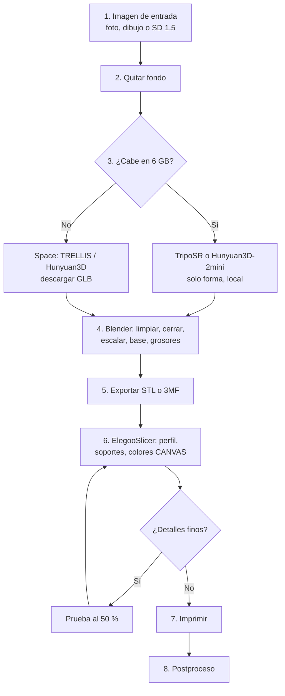

# De la IA a la impresora (flujo completo)

Parte de: [[39-IA-Modelado-3D/04 Flujo completo/_Índice Flujo completo|Flujo completo]]

> [!info] Cómo avanzar
> `progreso`: **pendiente** → **viendo** (estudiando) → **visto** (contestaste la autoevaluación sin abrir las respuestas) → **dominado** (hiciste el laboratorio o lo aplicaste de verdad).

## Contenido

### Qué es
Es la ruta completa, de una idea o foto hasta una pieza impresa en tu **[[Elegoo Centauri 2 Combo]]** (marco abierto, sin gabinete), usando IA para crear la forma. Une todos los temas del área: imagen de entrada, modelo de imagen a 3D (local o nube), limpieza en Blender, laminado en ElegooSlicer, impresión y postproceso. Esta nota es el mapa; cada paso tiene su propia nota y el [[Lab 4 - Del dibujo al objeto impreso con IA 3D]] lo practica de punta a punta.

### Cómo funciona

1. **Imagen** — [[Crear la imagen de entrada para IA 3D]], [[Stable Diffusion en 6 GB de VRAM]].
2. **Fondo** — [[Quitar el fondo de una imagen]].
3. **3D** — local: [[TripoSR]] o [[Hunyuan3D-2mini]]; nube: [[Modelos de imagen a 3D en la nube gratuita (Hugging Face y Colab)]].
4. **Blender** — [[Limpiar un modelo generado por IA en Blender]].
5. **Exportar** — STL para un color; 3MF si llevas partes de colores ([[Archivos para imprimir (STL, 3MF, OBJ y STEP)]]).
6. **Laminar** — [[ElegooSlicer y OrcaSlicer]], selecciona el perfil exacto de tu impresora y CANVAS; colores en [[Separar un modelo por colores para CANVAS]].
7. **Imprimir** — volumen de impresión de 256 × 256 × 256 mm según Elegoo. Como es de marco abierto, PLA, PETG y TPU son los materiales ideales; ABS, ASA y similares dan warping sin gabinete ([[Materiales que necesitan impresora cerrada (ABS, ASA, PC y nylon)]]).
8. **Postproceso** — [[Quitar soportes y limpiar piezas]], y si quieres, [[Pintura de figuras impresas]].

### Ejemplo: figura de 90 mm en PLA
- **Imagen:** dibujo propio de un ajolote, sombreado, foto con el iPhone.
- **3D:** TripoSR local, `--model-save-format glb --chunk-size 4096`; 25–40 s en tu GPU (mide el tuyo).
- **Blender:** borrar islas, escalar ×55.56 a 90 mm, Voxel Remesh 0.4 mm, Bisect para base plana, 3D Print Toolbox con grosor mínimo 1.2 mm, Decimate a ~200 mil triángulos, exportar STL.
- **ElegooSlicer:** PLA, capa de 0.12–0.16 mm para figura (más fino = mejor superficie curva, más tiempo), 2–3 perímetros, 10–15 % de relleno, soportes de árbol solo donde haya voladizos ([[Soportes (normales, árbol e interfaces)]]).
- **Prueba:** si las patas o branquias son delgadas, imprime primero al 50 % (45 mm). Recuerda que al escalar a la mitad los detalles también se adelgazan a la mitad: una branquia de 1.4 mm queda en 0.7 mm y puede no salir; eso no significa que a tamaño completo falle.
- **Impresión final** a 100 %, retiro de soportes y lijado ligero ([[Lijado y relleno de piezas impresas]]).

Los valores de capa, perímetros y relleno son puntos de partida; ajústalos con tus calibraciones.

### Caso: la cara inferior quedó redondeada
Muy común: la IA genera la base como continúa la forma. Sin base plana, la pieza toca la cama en un punto, necesita soportes y puede despegarse.
- En **Blender**: `Bisect` con *Fill* unos milímetros arriba del punto más bajo, o Boolean *Difference* con un cubo grande debajo.
- En el **laminador**: herramienta *Cortar* a cierta altura y conservar la parte superior.
- Alternativa: agrega una peana (cilindro) y únela con Boolean *Union*; queda como base decorativa.

### Cuándo hacer una impresión de prueba más pequeña
- Detalles finos o voladizos dudosos.
- Primera vez con un modelo de IA nuevo (para ver la espalda inventada en físico).
- Piezas grandes de muchas horas: una prueba de 1 hora evita perder 10.

### Errores comunes
1. **Saltar Blender.** La malla de IA casi nunca está lista: escala arbitraria, islas, base redonda.
2. **Juzgar la prueba al 50 % como si fuera la final.** Los grosores también se reducen a la mitad.
3. **Usar el perfil de otra impresora.** Selecciona exactamente tu modelo y el CANVAS en ElegooSlicer.
4. **No revisar la vista previa por capas.** Ahí ves paredes que no se imprimirán y zonas sin soporte ([[Errores típicos de los modelos generados por IA]]).

### Para profundizar
- [Página oficial de la Centauri 2 Combo](https://us.elegoo.com/products/centauri-2-combo)
- [TripoSR en GitHub](https://github.com/VAST-AI-Research/TripoSR)
- [3D Print Toolbox para Blender](https://extensions.blender.org/add-ons/print3d-toolbox/)

## Autoevaluación

Contesta primero en voz alta o en papel; luego despliega la respuesta.

> [!question]- Resume el flujo completo en pasos.
> 1) Imagen de entrada (foto, dibujo o SD 1.5). 2) Quitar fondo. 3) Imagen a 3D (TripoSR / Hunyuan3D-2mini local, o nube). 4) Blender: limpiar, cerrar, escalar, base, grosores. 5) Exportar STL/3MF. 6) Laminar en ElegooSlicer (soportes, colores). 7) Imprimir en la [[Elegoo Centauri 2 Combo]]. 8) Postproceso ([[Quitar soportes y limpiar piezas]]).

> [!question]- ¿Cuándo haces una impresión de prueba más pequeña?
> Siempre que el modelo tenga detalles finos o voladizos dudosos: imprime al 50 % para validar forma y soportes rápido. Recuerda que al escalar a la mitad los detalles también se adelgazan a la mitad.

> [!question]- Caso: la pieza tiene la cara inferior redondeada. ¿Qué haces?
> Corta una base plana en Blender (Bisect o Boolean con un cubo) o usa *Cortar* en el laminador. Sin base plana necesitarás soportes y la pieza puede despegarse. Ver [[Soportes (normales, árbol e interfaces)]].

## Práctica

- [[Lab 4 - Del dibujo al objeto impreso con IA 3D]]

