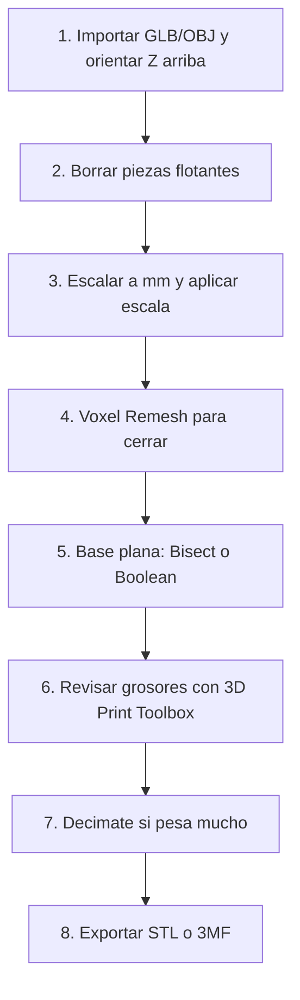

# Limpiar un modelo generado por IA en Blender

Parte de: [[39-IA-Modelado-3D/04 Flujo completo/_Índice Flujo completo|Flujo completo]]

> [!info] Cómo avanzar
> `progreso`: **pendiente** → **viendo** (estudiando) → **visto** (contestaste la autoevaluación sin abrir las respuestas) → **dominado** (hiciste el laboratorio o lo aplicaste de verdad).

## Contenido

### Qué es
Es convertir la malla que entrega la IA (OBJ o GLB, escala arbitraria, a veces abierta, con piezas sueltas y base redonda) en un **sólido imprimible**: una sola malla cerrada, con medidas reales en milímetros, base plana y grosores que la boquilla de 0.4 mm de tu [[Elegoo Centauri 2 Combo]] pueda reproducir. Se hace en **Blender** (gratis) y es el paso que separa "un modelo bonito en pantalla" de "una pieza que sale bien".

### Cómo funciona: orden recomendado

1. **Importar y orientar.** `File > Import > glTF 2.0` u `OBJ`. Rota para que el objeto quede de pie sobre Z.
2. **Piezas flotantes.** En Edit Mode, coloca el cursor sobre el cuerpo principal, `L` (*Select Linked*), `Ctrl+I` (invertir) y borra.
3. **Escala.** Con 1 unidad = 1 mm (*Scene > Units*: Unit Scale 0.001, Length en milímetros), mide la altura en el panel `N` y escala uniforme. Aplica con `Ctrl+A > Scale`.
4. **Voxel Remesh.** Modificador *Remesh*, modo *Voxel*. Reconstruye toda la superficie como un solo cuerpo cerrado, sin huecos ni auto-intersecciones pequeñas. Elige el vóxel **después de escalar**: 0.3–0.5 mm conserva detalle para boquilla de 0.4 mm. **Remesh borra colores por vértice y UV:** guarda una copia antes si los necesitas como referencia de color. Ver [[Remesh y Dyntopo en Blender]].
5. **Base plana.** `Bisect` con *Fill* en Edit Mode, o Boolean *Difference* con un cubo bajo el modelo ([[Modificador Boolean en Blender]]).
6. **Grosores.** El [3D Print Toolbox](https://extensions.blender.org/add-ons/print3d-toolbox/) revisa *Solid* (no manifold), *Intersections*, *Thickness* (pon 1.2 mm) y *Overhang*, y puede hacer *Make Manifold*.
7. **Decimate.** Si quedó en millones de triángulos, modificador *Decimate* (*Collapse*) hasta 100–300 mil.
8. **Exportar.** STL nativo (Blender 4.2+) o 3MF con la [extensión 3MF](https://extensions.blender.org/add-ons/threemf-io/). Ver [[Preparar un modelo de Blender para imprimir]].

### Ejemplo con números
TripoSR te da una figura de **1.62 unidades** de alto y la quieres de **90 mm**.
- **Factor de escala:** 90 / 1.62 = **55.56**.
- **Oreja de 0.018 unidades:** tras escalar mide 0.018 × 55.56 = **1.0 mm**, menos que tu mínimo de 1.2 mm. O la engrosas esculpiendo (*Inflate*, *Draw*), o escalas toda la figura a 1.2 / 0.018 = 66.7 → altura ≈ **108 mm**.
- **Líneas de pared en 1.2 mm con boquilla de 0.4:** 1.2 / 0.4 = 3 líneas en teoría; como el ancho de línea suele ser 0.42–0.45 mm, en la práctica 2–3. Por eso 1.2 mm es un mínimo razonable ([[Grosor de pared y relleno según la carga]]).
- **Vóxeles a lo alto:** 90 / 0.5 = **180**; con 0.25 mm, **360**. Reducir el vóxel a la mitad multiplica los polígonos de superficie por unas 4 veces (2²).
- **Filamento al escalar de 50 a 100 mm:** el volumen crece con el cubo, 2³ = **8 veces**; con relleno bajo, el gasto se acerca más al área de paredes (2² = 4), así que espera entre 4× y 8×.

### Script opcional (Python de Blender)
```python
import bpy
obj = bpy.context.active_object
objetivo_mm = 90.0
factor = objetivo_mm / obj.dimensions.z            # ej. 90 / 1.62 = 55.56
obj.scale = (factor, factor, factor)
bpy.ops.object.transform_apply(location=False, rotation=False, scale=True)

remesh = obj.modifiers.new("Remesh", 'REMESH')
remesh.mode = 'VOXEL'
remesh.voxel_size = 0.4                            # mm, después de escalar
bpy.ops.object.modifier_apply(modifier=remesh.name)
print("Altura final:", round(obj.dimensions.z, 2), "mm")
```

### Cuándo usarlo y cuándo no
- **Siempre**, para cualquier malla de IA antes del laminador.
- Si el defecto es grande (proporciones mal, parte faltante), **regenera** con otra imagen en vez de esculpir horas ([[Errores típicos de los modelos generados por IA]]).

### Errores comunes
1. **Escalar en Object Mode y exportar sin aplicar la escala.** Aplica `Ctrl+A > Scale` y confirma las dimensiones en el panel `N`.
2. **Elegir el tamaño de vóxel antes de escalar.** 0.4 "unidades" en una figura de 1.6 unidades borra todo el detalle.
3. **Perder los colores con Remesh.** Duplica el objeto antes (`Shift+D`) y oculta la copia como referencia.
4. **Olvidar la base.** Una base redonda necesita soportes y se despega.

### Para profundizar
- [Modificador Remesh (manual de Blender)](https://www.blender.org/manual/en/modeling/modifiers/generate/remesh.html)
- [3D Print Toolbox](https://extensions.blender.org/add-ons/print3d-toolbox/)
- [Extensión 3MF para Blender](https://extensions.blender.org/add-ons/threemf-io/)
- [Modificador Decimate (manual de Blender)](https://www.blender.org/manual/en/modeling/modifiers/generate/decimate.html)

## Ejercicios

Resuélvelos en papel o en la herramienta; la solución está plegada.

> [!question]- TripoSR te da una figura de 1.62 unidades de alto. La quieres de 90 mm. ¿Qué factor de escala aplicas si en Blender 1 unidad = 1 mm?
> 90 / 1.62 = **55.56**. Escala uniforme ×55.56 y aplica escala. Verifica en el panel `N` que la altura sea 90 mm.

> [!question]- En esa figura, una oreja mide 0.018 unidades de grosor antes de escalar. ¿Cuánto mide tras escalar a 90 mm? ¿Se imprime bien con boquilla de 0.4 mm si tu mínimo para detalles es 1.2 mm?
> 0.018 × 55.56 = **1.0 mm** < 1.2 mm: queda frágil o se pierde. Opciones: engrosarla (esculpir con *Inflate*/*Draw* o *Displace*), o escalar la figura a 1.2 / 0.018 = 66.7 → altura 1.62 × 66.7 ≈ **108 mm**.

> [!question]- Pasas una figura de 50 mm a 100 mm de alto. ¿Cuántas veces más filamento usa aproximadamente (mismo relleno y perímetros)?
> El volumen crece con el cubo del factor: 2³ = **8 veces** el volumen (en piezas con mucho relleno). Con relleno bajo, la parte de paredes crece más como el área (2² = 4), así que el aumento real queda entre 4× y 8×.

> [!question]- Aplicas Voxel Remesh a una figura de 90 mm con vóxel de 0.5 mm. ¿Cuántos vóxeles hay a lo alto? ¿Y con 0.25 mm?
> 90 / 0.5 = **180** vóxeles; 90 / 0.25 = **360**. Reducir el vóxel a la mitad multiplica aproximadamente por 4 los polígonos de la superficie (2²): más detalle, archivo más pesado.

> [!question]- La figura mide 30 mm de ancho en la base. La boquilla es de 0.4 mm. ¿Cuántas líneas de pared caben en un detalle de 1.2 mm?
> 1.2 / 0.4 ≈ **3 líneas** (en la práctica el ancho de línea suele ser algo mayor que la boquilla, ~0.42–0.45 mm, así que serán 2–3). Por eso 1.2 mm es un mínimo razonable para detalles que deban quedar firmes. Ver [[Grosor de pared y relleno según la carga]].

## Autoevaluación

Contesta primero en voz alta o en papel; luego despliega la respuesta.

> [!question]- ¿Cuál es el orden recomendado de limpieza?
> 1) Importar GLB/OBJ y orientar (Z arriba). 2) Borrar piezas flotantes (*Select Linked* y borrar). 3) **Voxel Remesh** para cerrar la malla. 4) Base plana (cortar con *Bisect* o Boolean). 5) **Escalar** a mm y aplicar escala (`Ctrl+A`). 6) Revisar grosores con [3D Print Toolbox](https://extensions.blender.org/add-ons/print3d-toolbox/). 7) *Decimate* si es muy pesada. 8) Exportar STL/3MF. Ver [[Preparar un modelo de Blender para imprimir]] y [[Remesh y Dyntopo en Blender]].

> [!question]- ¿Por qué Voxel Remesh y qué tamaño de vóxel usar?
> Reconstruye toda la superficie como una malla cerrada de un solo cuerpo, eliminando huecos y auto-intersecciones pequeñas. Elige el vóxel **después de escalar**: 0.3–0.5 mm conserva detalle para boquilla de 0.4 mm; vóxeles más grandes suavizan y aligeran. Ojo: Remesh borra colores por vértice y UV; si los necesitas para colores, guarda una copia antes.

> [!question]- ¿Qué revisa 3D Print Toolbox que te importa en modelos de IA?
> *Solid* (no manifold), *Intersections*, *Thickness* (paredes más delgadas que el valor que pongas, p. ej. 1.2 mm) y *Overhang*. También puede escalar a un tamaño objetivo y hacer *Make Manifold*.

> [!question]- Error común: escalar el objeto en Object Mode y exportar sin aplicar escala.
> Algunos exportadores y herramientas leen la escala de forma distinta; aplica la escala (`Ctrl+A → Scale`) y confirma las dimensiones en el panel `N` antes de exportar.

## Práctica

- [[Lab 4 - Del dibujo al objeto impreso con IA 3D]]
- [[Lab 5 - Separar un modelo generado en 4 colores para CANVAS]]

