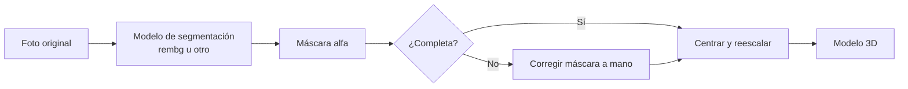

# Quitar el fondo de una imagen

Parte de: [[39-IA-Modelado-3D/04 Flujo completo/_Índice Flujo completo|Flujo completo]]

> [!info] Cómo avanzar
> `progreso`: **pendiente** → **viendo** (estudiando) → **visto** (contestaste la autoevaluación sin abrir las respuestas) → **dominado** (hiciste el laboratorio o lo aplicaste de verdad).

## Contenido

### Qué es
Es separar el objeto del resto de la imagen y dejar solo su silueta sobre un fondo neutro (o transparente). Los modelos de imagen a 3D esperan **un objeto aislado**: si les das una foto con mesa, pared o plantas, intentan reconstruir eso también y aparecen planos, bultos o "alas" pegadas a la malla. Es un paso corto que evita mucha limpieza después.

### Cómo funciona
Las herramientas modernas usan un **modelo de segmentación** que estima, píxel por píxel, si pertenece al objeto principal. El resultado es una **máscara** (blanco = objeto, negro = fondo) que se aplica como canal alfa.



**Qué hace TripoSR por su cuenta.** Por defecto, TripoSR quita el fondo con **`rembg`** y reescala el objeto para que ocupe el 85 % del cuadro (`--foreground-ratio 0.85`). Si ya lo quitaste tú, usa `--no-remove-bg`: en ese caso espera una imagen RGB con **fondo gris** y el objeto ya bien dimensionado. Otros modelos (Hunyuan3D, SF3D, los Spaces) también traen su propio quitafondo.

### Ejemplo: con rembg en tu PC
```powershell
# En un entorno aparte para no mezclar dependencias
py -3.10 -m venv C:\IA3D\rembg-env
C:\IA3D\rembg-env\Scripts\Activate.ps1
pip install "rembg[cli]"

# Una imagen
rembg i C:\fotos\alcancia.jpg C:\fotos\alcancia_sin_fondo.png

# Una carpeta completa
rembg p C:\fotos\entrada C:\fotos\sin_fondo
```
El nombre exacto del paquete extra (`[cli]`, `[gpu]`) puede variar entre versiones: revisa el README de rembg (Pendiente de confirmar para la versión actual). Abre el PNG resultante sobre un fondo de color en tu editor para ver bordes y huecos.

Para pasarla a TripoSR con `--no-remove-bg`, compón el PNG sobre un fondo gris medio y céntralo; o, más simple, deja que TripoSR haga todo y no uses esa opción.

### Caso: el quitafondo se comió una parte del objeto
Pasa mucho con partes **delgadas o del mismo color que el fondo**: antenas, colas, bigotes, asas, rejas. Lo que falte en la máscara **faltará en el modelo**.
1. **Corrige la máscara a mano** en un editor (GIMP, Photoshop, Affinity, el que uses): pinta de blanco la parte perdida en la capa de máscara.
2. **Vuelve a tomar la foto** con más contraste: objeto oscuro sobre fondo claro o al revés, luz que separe el borde.
3. **Engrosa la parte en el diseño** si es demasiado fina para imprimirse de todos modos (menos de 1.2 mm a escala final no aguantará).
4. **Agrégala después en Blender** si es simple (una antena es un cilindro).

### Cuándo usarlo y cuándo no
- **Siempre** que la foto tenga fondo real.
- **Puedes saltarlo** si la imagen viene de SD con fondo blanco liso y el modelo trae quitafondo, pero revisa el resultado.
- **Hazlo tú** (en vez del automático del modelo) cuando el objeto tenga partes delgadas: así controlas la máscara.

### Errores comunes
1. **No revisar la máscara.** Un hueco en el borde se vuelve un mordisco en la malla.
2. **Dejar sombras proyectadas.** La sombra en el piso puede quedarse como una "base" deforme; recórtala.
3. **Usar `--no-remove-bg` con fondo transparente o blanco.** TripoSR espera fondo gris en ese modo.
4. **Quitar el fondo a una imagen con varios objetos.** El quitafondo conservará todos; recorta antes a uno solo.

### Para profundizar
- [rembg en GitHub](https://github.com/danielgatis/rembg)
- [run.py de TripoSR (opciones de fondo)](https://github.com/VAST-AI-Research/TripoSR/blob/main/run.py)
- [TripoSR en GitHub](https://github.com/VAST-AI-Research/TripoSR)

## Autoevaluación

Contesta primero en voz alta o en papel; luego despliega la respuesta.

> [!question]- ¿Por qué hay que quitar el fondo?
> Los modelos de imagen a 3D esperan solo el objeto; un fondo con muebles o textura se reconstruye como parte de la malla (planos o bultos extra).

> [!question]- ¿Qué hace TripoSR con el fondo?
> Por defecto lo quita automáticamente (usa `rembg`) y reescala el objeto según `--foreground-ratio` (0.85). Si ya lo quitaste tú, `--no-remove-bg` espera una imagen RGB con **fondo gris** y el objeto bien dimensionado.

> [!question]- Caso: el quitafondo se comió una parte del objeto (por ejemplo, una antena delgada). ¿Qué haces?
> Corrige la máscara a mano en un editor (GIMP o el que uses), o vuelve a tomar la foto con más contraste entre objeto y fondo. Lo que falte en la máscara faltará en el modelo.

## Práctica

- [[Lab 2 - Primer modelo con TripoSR desde una foto propia]]

