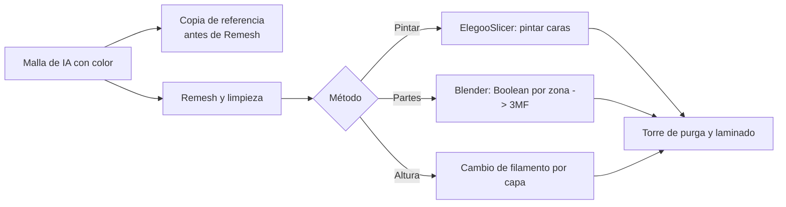

# Separar un modelo por colores para CANVAS

Parte de: [[39-IA-Modelado-3D/04 Flujo completo/_Índice Flujo completo|Flujo completo]]

> [!info] Cómo avanzar
> `progreso`: **pendiente** → **viendo** (estudiando) → **visto** (contestaste la autoevaluación sin abrir las respuestas) → **dominado** (hiciste el laboratorio o lo aplicaste de verdad).

## Contenido

### Qué es
Es preparar un modelo generado por IA para imprimirlo en **hasta 4 colores** con el sistema **CANVAS** de tu [[Elegoo Centauri 2 Combo]]. La IA te da un color "pintado" (por vértice o textura), pero la impresora no lee eso: el laminador asigna un filamento a cada **cara pintada** o a cada **parte**. Tu trabajo es traducir el color de la IA a zonas que el laminador entienda, con el menor número de cambios posible ([[Sistema multicolor CANVAS de Elegoo]]).

### Cómo funciona: tres caminos
| Método | Cómo | Bueno para | Limitación |
|---|---|---|---|
| **1. Pintar en ElegooSlicer** | Una sola malla cerrada; usas la herramienta de pintura de color sobre caras | Lo más simple; ojos, detalles, manchas | Bordes de color siguen los triángulos |
| **2. Partes separadas** | En Blender cortas el sólido en piezas **cerradas** (Boolean) y exportas 3MF o varios STL que cargas como un objeto con partes | Bordes limpios, zonas grandes | Más trabajo en Blender |
| **3. Por altura de capa** | Cambias de filamento a cierta altura | Letreros, bases de color distinto | Solo franjas horizontales |

Ver [[Impresión multicolor (pintar colores y torre de purga)]] y [[Modelos pensados para impresión multicolor]].

### ¿Sirve la textura o el color por vértice de la IA?
Como **referencia visual**, sí: te dice dónde va cada color. Como dato para imprimir, no directamente: ElegooSlicer asigna filamentos por caras pintadas o por partes. Además, Voxel Remesh **borra** el color por vértice y las UV, así que guarda una copia antes de limpiar y úsala de guía (en Blender, ponla a un lado o con transparencia). Si tu versión del laminador puede importar colores de un OBJ o 3MF y reducirlos a N filamentos: (Pendiente de confirmar).

### Ejemplo: un búho en 4 colores
Colores en el CANVAS: 1) café (cuerpo), 2) beige (panza y cara), 3) negro (ojos), 4) naranja (pico y patas).
1. Limpia y escala el búho a 80 mm en Blender ([[Limpiar un modelo generado por IA en Blender]]). Exporta STL de una sola malla.
2. En ElegooSlicer, asigna el café como color base del objeto.
3. Con la herramienta de pintura, pinta la panza y la cara de beige; usa *relleno inteligente* o un pincel grande para zonas amplias.
4. Pinta los ojos de negro y el pico y las patas de naranja.
5. Revisa la vista por capas: ¿cuántas capas tienen cambio de color? Los ojos y el pico están en la parte alta; las patas, abajo.
6. Lamina y revisa el estimado de filamento de purga y tiempo.

Para bordes limpios en la panza, alternativa: en Blender duplica el cuerpo, haz un objeto cortador con la forma de la panza y usa Boolean *Intersect* (panza) y *Difference* (cuerpo sin panza). Cada pieza queda **cerrada**; exporta como 3MF con partes.

### Cómo reducir la purga
- **Un color base** para casi todo y los demás en **zonas compactas**.
- Agrupa colores en **pocas capas**: detalles arriba (ojos) o abajo (base) en lugar de repartidos por toda la altura.
- Evita alternar colores en muchas capas: cada cambio purga filamento y tarda.
- Usa la opción de purgar en el relleno o en un objeto de sacrificio si tu laminador lo permite.
- Considera pintar a mano detalles diminutos después de imprimir ([[Pintura de figuras impresas]]).

### Cuándo usarlo y cuándo no
- **Pintar en el laminador** para el 80 % de los casos.
- **Partes en Blender** cuando quieres bordes rectos o curvas limpias y grandes.
- **Un solo color y pintar después** si el diseño tiene muchos detalles pequeños de colores distintos.

### Errores comunes
1. **Cortar las piezas con *Separate* (`P`) en Edit Mode.** Cada pieza queda **abierta** (sin tapa en el corte) y el laminador la rechaza o la rellena mal. Usa Boolean con un objeto cortador.
2. **Pintar sobre la malla sin Remesh.** Si la malla de IA tiene huecos, la pintura y el laminado fallan.
3. **Repartir el color en todas las capas.** La torre de purga crece y la impresión dura horas de más.
4. **Pasar TPU por el CANVAS.** No se debe; ver [[Sistema multicolor CANVAS de Elegoo]].

### Para profundizar
- [Página oficial de la Centauri 2 Combo](https://us.elegoo.com/products/centauri-2-combo)
- [Modificador Remesh (manual de Blender)](https://www.blender.org/manual/en/modeling/modifiers/generate/remesh.html)
- [Extensión 3MF para Blender](https://extensions.blender.org/add-ons/threemf-io/)

## Autoevaluación

Contesta primero en voz alta o en papel; luego despliega la respuesta.

> [!question]- ¿Qué formas hay de llevar un modelo de IA a 4 colores?
> 1) **Pintar** caras en ElegooSlicer (herramienta de pintura de color sobre una sola malla cerrada): la más simple. 2) **Partes separadas** en Blender: cortas el sólido en piezas cerradas (Boolean) y exportas 3MF o varios STL que cargas como un objeto con partes. 3) **Por altura de capa** para letreros y bases. Ver [[Impresión multicolor (pintar colores y torre de purga)]] y [[Modelos pensados para impresión multicolor]].

> [!question]- ¿Sirve la textura o el color por vértice que generó la IA?
> Como **referencia visual** sí: te dice dónde va cada color. Para imprimir, ElegooSlicer asigna filamentos por caras pintadas o por partes, no por textura. Si tu versión del laminador puede importar colores de un OBJ y reducirlos a N filamentos: (Pendiente de confirmar).

> [!question]- Error común: cortar las piezas de color con *Separate* (`P`) en Edit Mode.
> Eso deja cada pieza **abierta** (sin tapa en el corte) y el laminador la rechaza o la rellena mal. Usa Boolean (*Difference* / *Intersect*) con un objeto cortador para que cada pieza quede cerrada.

> [!question]- ¿Cómo reduces la purga en un modelo de IA con 4 colores?
> Simplifica: un color base para casi todo y los otros en zonas compactas (ojos, base, detalles en la parte superior). Muchos cambios de color en muchas capas = torre de purga grande y horas de más. Ver [[Sistema multicolor CANVAS de Elegoo]].

## Práctica

- [[Lab 5 - Separar un modelo generado en 4 colores para CANVAS]]

