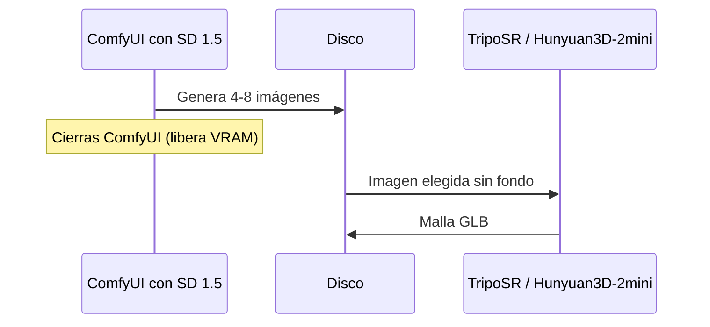

# Stable Diffusion en 6 GB de VRAM

Parte de: [[39-IA-Modelado-3D/04 Flujo completo/_Índice Flujo completo|Flujo completo]]

> [!info] Cómo avanzar
> `progreso`: **pendiente** → **viendo** (estudiando) → **visto** (contestaste la autoevaluación sin abrir las respuestas) → **dominado** (hiciste el laboratorio o lo aplicaste de verdad).

## Contenido

### Qué es
**Stable Diffusion 1.5** es un modelo abierto de texto a imagen que corre bien en tarjetas modestas. En este flujo lo usas para generar la **imagen de entrada** del modelo 3D cuando no tienes foto ni dibujo: describes el objeto y obtienes una vista limpia, de un solo objeto, con fondo liso. En una GTX 1660 Ti de 6 GB es la opción más práctica por tamaño, velocidad y compatibilidad con las GTX 16.

### Por qué SD 1.5 y no modelos más grandes
- Genera nativamente a **512×512**, que es justo la resolución que esperan muchos modelos de imagen a 3D (SF3D trabaja a 512×512).
- Sus pesos caben con holgura en 6 GB **incluso en FP32**, que es lo que a veces necesitas en una GTX 16 para evitar imágenes negras ([[Tarjetas GTX 16 y media precisión (FP16)]]).
- Modelos más grandes (SDXL y posteriores) se vuelven muy lentos o no caben sin trucos agresivos de memoria en tu tarjeta.
- Hay miles de modelos derivados y LoRA de estilo, gratuitos (revisa la licencia de cada uno).

### Cómo funciona en tu tarjeta
**En ComfyUI** (recomendado): detecta la GTX 16 y no usa FP16 por defecto. Si falta memoria, arranca con `--lowvram`. Flujo básico: *Load Checkpoint* (SD 1.5) → *CLIP Text Encode* (positivo y negativo) → *KSampler* → *VAE Decode* → *Save Image*. Ver [[ComfyUI para generación 3D]].

**En AUTOMATIC1111** (WebUI): según su [guía de problemas](https://github.com/AUTOMATIC1111/stable-diffusion-webui/wiki/Troubleshooting), para 16XX:
```bat
set COMMANDLINE_ARGS=--upcast-sampling --xformers
rem si salen imágenes negras o verdes:
set COMMANDLINE_ARGS=--upcast-sampling --xformers --no-half-vae
rem último recurso (más VRAM):
set COMMANDLINE_ARGS=--precision full --no-half --medvram
```

### Ejemplo: prompt para una imagen que sirva para 3D
```text
Positivo:
a cute ceramic owl figurine, full body, three-quarter view, single object,
centered, plain white background, soft studio lighting, simple shapes,
matte material, product photo

Negativo:
multiple objects, cropped, cut off, text, watermark, busy background,
reflections, glass, shadow on background, blurry
```
Parámetros de partida: 512×512, 25–30 pasos, CFG 7, sampler Euler a o DPM++ 2M, lote de 4. Elige la imagen con silueta más clara y vista de tres cuartos real. Ajusta y compara: estos valores son un punto de partida, no una regla.

Las palabras que más ayudan para 3D: **full body** (no cortar), **three-quarter view** (volumen), **plain background** (fácil de quitar), **soft lighting** (sin sombras duras), **simple shapes** y **matte** (menos detalle imposible de imprimir y sin reflejos).

### Flujo de trabajo en 6 GB

Primero generas todas las imágenes, **cierras** el programa y luego corres el modelo 3D. Si ComfyUI tiene el flujo 3D nativo, él mismo descarga SD antes de cargar Hunyuan3D, pero mide con `nvidia-smi` para confirmarlo.

### Cuándo usarlo y cuándo no
- **Úsalo** para explorar ideas de figuras decorativas o personajes originales.
- **No** para copiar personajes de marcas o franquicias: aunque la IA "lo dibuje", siguen protegidos ([[Propiedad y uso comercial de modelos generados por IA]]).
- **No** si ya tienes un dibujo propio: tu dibujo da más control y refuerza tu autoría.

### Errores comunes
1. **Generar la imagen y el 3D a la vez con ambos programas abiertos.** Compiten por 6 GB y uno falla. Genera, cierra y luego convierte.
2. **Arrancar con `--precision full --no-half` sin necesidad.** Gastas el doble de VRAM; empieza con `--upcast-sampling`.
3. **Pedir resoluciones altas.** SD 1.5 a 1024×1024 duplica objetos y deformaciones; quédate en 512.
4. **Prompts con escena.** "Un búho en un bosque" trae ramas y fondo; pide solo el objeto.

### Para profundizar
- [Stable Diffusion 1.5 en Hugging Face](https://huggingface.co/stable-diffusion-v1-5/stable-diffusion-v1-5)
- [ComfyUI en GitHub](https://github.com/Comfy-Org/ComfyUI)
- [Guía de problemas de AUTOMATIC1111](https://github.com/AUTOMATIC1111/stable-diffusion-webui/wiki/Troubleshooting)

## Autoevaluación

Contesta primero en voz alta o en papel; luego despliega la respuesta.

> [!question]- ¿Por qué SD 1.5 y no modelos más grandes en tu equipo?
> SD 1.5 genera a 512×512 y sus pesos caben con holgura en 6 GB incluso en FP32, que es lo que necesitas en una GTX 16. Modelos más grandes (SDXL y posteriores) se vuelven lentos o no caben sin trucos agresivos.

> [!question]- ¿Qué configuración usas en una GTX 1660 Ti?
> En **ComfyUI** no tienes que hacer nada: detecta la tarjeta y evita FP16; si falta memoria, arranca con `--lowvram`. En **AUTOMATIC1111**: `--upcast-sampling --xformers`, y si salen imágenes negras `--no-half-vae`; último recurso `--precision full --no-half` con `--medvram` ([guía](https://github.com/AUTOMATIC1111/stable-diffusion-webui/wiki/Troubleshooting)).

> [!question]- ¿Qué prompt ayuda a que la imagen sirva para 3D?
> Describe un objeto único, vista completa, fondo liso y luz suave: p. ej. `a cute ceramic owl figurine, full body, three-quarter view, plain white background, soft studio lighting, simple shapes`. En negativo: `multiple objects, cropped, text, busy background`.

> [!question]- Error común: generar la imagen y el 3D a la vez con ambos programas abiertos.
> Los dos compiten por 6 GB de VRAM. Genera las imágenes, **cierra** ComfyUI/WebUI y luego corre el modelo 3D.

## Práctica

- [[Lab 4 - Del dibujo al objeto impreso con IA 3D]]

