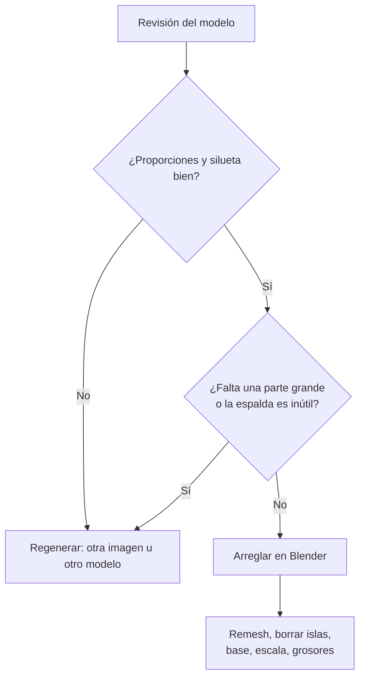

# Errores típicos de los modelos generados por IA

Parte de: [[39-IA-Modelado-3D/05 Calidad y criterio/_Índice Calidad y criterio|Calidad y criterio]]

> [!info] Cómo avanzar
> `progreso`: **pendiente** → **viendo** (estudiando) → **visto** (contestaste la autoevaluación sin abrir las respuestas) → **dominado** (hiciste el laboratorio o lo aplicaste de verdad).

## Contenido

### Qué es
Es el catálogo de defectos que casi siempre aparecen en una malla generada por IA y la decisión de **arreglar o regenerar**. Reconocerlos rápido te permite saber si vale la pena invertir tiempo en Blender o si conviene cambiar la imagen o el modelo. Los defectos vienen de dos fuentes: lo que el modelo **no vio** (la espalda, los huecos) y cómo **extrae la malla** (marching cubes, umbrales).

### Cómo funciona: los defectos más comunes
| Defecto | Por qué pasa | Dónde lo notas |
|---|---|---|
| **Parte trasera inventada o plana** | La imagen no tenía esa información | Al girar el modelo |
| **Detalles fundidos** (dedos, orejas, patas juntas) | Resolución limitada o partes que se tocan en la imagen | Vista de cerca |
| **Piezas flotantes y ruido** | Islas pequeñas del campo implícito | Edit Mode, *Select Linked* |
| **Escalones o superficie "de vóxel"** | Rejilla de marching cubes gruesa | Con luz rasante en el visor |
| **Grosores menores a lo imprimible** | La IA no sabe de boquillas | 3D Print Toolbox, *Thickness* |
| **Escala arbitraria** | Sale en "unidades", no en mm | Panel `N` |
| **Base redondeada** | La forma continúa por debajo | Vista lateral |
| **Huecos rellenos** (asas, aros) | No se veían en la imagen | Vista de cerca |
| **Malla abierta o con auto-intersecciones** | Extracción imperfecta | *Select Non Manifold* |

### Arreglar en Blender o regenerar

**Se arreglan en Blender** (minutos):
- Ruido, piezas flotantes, huecos pequeños: borrar islas y **Voxel Remesh**.
- Base redonda: **Bisect** o Boolean.
- Escala: escalar y aplicar.
- Grosores: esculpir con *Inflate* o escalar toda la pieza.
- Escalones: suavizado ligero (*Smooth* en escultura) después del Remesh.
Ver [[Limpiar un modelo generado por IA en Blender]] y [[Reparar mallas para impresión]].

**Mejor regenerar** (cambiar imagen, ángulo o modelo):
- Proporciones mal (cabeza enorme por gran angular).
- Partes grandes faltantes (un brazo entero).
- Espalda inútil cuando la pieza se verá de todos lados.
- Objetos fundidos que deberían estar separados.

Si la espalda importa, otra opción es esculpirla ([[Escultura digital en Blender]]) o usar un modelo multivista.

### Ejemplo: revisión en 5 minutos
Generas un perro con TripoSR. Revisión:
1. Giras: la espalda está lisa pero aceptable para una figura de escritorio. **Sigue.**
2. Las patas delanteras están fundidas en un bloque. Para una figura de 70 mm, aceptable; si quieres patas separadas, **regenera** con una foto lateral de tres cuartos.
3. En Edit Mode, *Select Linked* muestra 12 islas pequeñas: **borrar**.
4. Base redonda: **Bisect**.
5. Escalas a 70 mm; la cola mide 0.9 mm de grosor: **engrosar** con *Inflate* o aceptar que se rompa.
6. Laminas y revisas la vista previa por capas.

### No te saltes la vista previa por capas
En ElegooSlicer, después de laminar, recorre las capas con el deslizador:
- **Paredes que no aparecen:** demasiado delgadas para el ancho de línea; se omiten sin aviso.
- **Islas en el aire:** zonas que empiezan flotando y necesitan soporte ([[Voladizos y puentes]]).
- **Huecos en la superficie superior:** pocas capas superiores sobre relleno.
Corrige en Blender o en los ajustes y vuelve a laminar. Esta revisión toma un minuto y evita impresiones fallidas de horas.

### Cuándo usarlo y cuándo no
- **Siempre** como checklist antes de invertir tiempo en limpieza.
- Si encuentras más de 2–3 defectos de "regenerar", cambia de imagen antes de seguir.

### Errores comunes
1. **No revisar la vista previa por capas del laminador.** Ahí aparecen paredes que no se imprimen y zonas sin soporte.
2. **Pasar horas esculpiendo una mala generación.** Regenerar con mejor imagen suele ser más rápido.
3. **Juzgar el modelo solo de frente.** Siempre gíralo.
4. **Suavizar demasiado.** Borra detalles que sí se imprimirían; suaviza solo los escalones.

### Para profundizar
- [3D Print Toolbox para Blender](https://extensions.blender.org/add-ons/print3d-toolbox/)
- [Modificador Remesh (manual de Blender)](https://www.blender.org/manual/en/modeling/modifiers/generate/remesh.html)
- [run.py de TripoSR (resolución de malla)](https://github.com/VAST-AI-Research/TripoSR/blob/main/run.py)

## Autoevaluación

Contesta primero en voz alta o en papel; luego despliega la respuesta.

> [!question]- ¿Cuáles son los defectos más comunes?
> 1) Parte trasera inventada o plana. 2) Detalles fundidos (dedos, orejas). 3) Piezas flotantes y ruido. 4) Superficie con "escalones" de marching cubes. 5) Grosores menores de lo imprimible. 6) Escala arbitraria. 7) Base redondeada.

> [!question]- ¿Cuáles arreglas en Blender y cuáles mejor regeneras?
> Arreglas: ruido, piezas flotantes, huecos, base, escala, grosores (Remesh, esculpir, Boolean). Regeneras con otra imagen o modelo: proporciones mal, partes faltantes grandes o una parte trasera inútil.

> [!question]- Error común: no revisar la pieza en la vista previa por capas del laminador.
> Ahí aparecen paredes que no se imprimen (demasiado delgadas) y zonas sin soporte. Revísala antes de mandar a imprimir.

## Práctica

- [[Lab 7 - Escaneo con iPhone vs IA del mismo objeto]]

