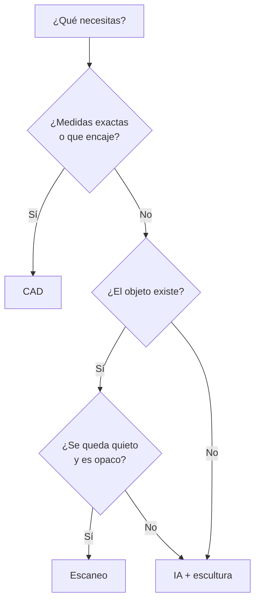

# IA vs CAD vs escaneo (cuándo usar cada uno)

Parte de: [[39-IA-Modelado-3D/05 Calidad y criterio/_Índice Calidad y criterio|Calidad y criterio]]

> [!info] Cómo avanzar
> `progreso`: **pendiente** → **viendo** (estudiando) → **visto** (contestaste la autoevaluación sin abrir las respuestas) → **dominado** (hiciste el laboratorio o lo aplicaste de verdad).

## Contenido

### Qué es
Son las tres formas principales de obtener un modelo 3D para imprimir, y cada una resuelve un problema distinto. **CAD** construye piezas con medidas exactas a partir de bocetos y operaciones. **Escaneo** (fotogrametría o LiDAR) copia la forma de un objeto que existe. **IA** genera una forma plausible a partir de una imagen o texto. Elegir bien te evita forzar una herramienta a hacer lo que no sabe.

### Cómo funciona cada uno
| | CAD | Escaneo | IA (imagen a 3D) |
|---|---|---|---|
| Entrada | Medidas, bocetos, restricciones | Muchas fotos o LiDAR del objeto real | Una imagen o texto |
| Precisión dimensional | Exacta | Buena (depende del método) | **Ninguna**: escala arbitraria |
| Parte trasera | La diseñas | Real (si la escaneas) | **Inventada** |
| Formas orgánicas | Difícil | Muy bien | Muy bien |
| Objetos que no existen | Sí | No | Sí |
| Herramientas gratuitas | Onshape, FreeCAD, Tinkercad | Apps del iPhone, fotogrametría | TripoSR, Hunyuan3D-2mini, Spaces |
| Notas | [[Onshape (plan gratuito)]], [[FreeCAD]] | [[Fotogrametría y escaneo con iPhone]] | [[De la IA a la impresora (flujo completo)]] |

### Cuándo usar cada uno
**CAD** para piezas **funcionales**: soportes para la Osmo Pocket o el DJI Mic, cajas para electrónica, repuestos, adaptadores, cualquier cosa con tolerancias o que deba encajar. La IA no respeta medidas: un agujero "de 6 mm" puede salir de 5.3 o de 7. Ver [[Tolerancias y holguras para piezas que encajan]] y [[Accesorios impresos para foto, video y dron]].

**Escaneo** cuando el objeto **existe** y quieres su forma real de todos lados: una figura de barro, una pieza de un mueble, una escultura propia. Funciona mal con objetos brillantes, transparentes o que se mueven. Después hay que limpiar ([[Limpiar un escaneo y hacerlo imprimible]]).

**IA** para figuras **orgánicas o decorativas que no existen** todavía: un personaje de tu dibujo, un prototipo visual rápido, una base para esculpir encima. También cuando escanear es imposible y te basta con una aproximación.

### Ejemplo: una figura de tu mascota
Escanear a un perro o gato es difícil: se mueve y el pelo confunde a la fotogrametría. La IA desde una buena foto da una figura **reconocible**, pero inventa la espalda y funde las patas.
Mejor combinación:
1. Toma varias fotos con el iPhone en luz pareja, de tres cuartos, a la altura del animal.
2. Genera con TripoSR o Hunyuan3D-2mini (o TRELLIS en la nube si quieres más detalle).
3. En Blender, corrige proporciones y espalda con escultura ([[Escultura digital en Blender]]), usando las otras fotos de referencia.
4. Agrega una base con su nombre en CAD o en Blender.
5. Imprime y pinta, o usa CANVAS para 2–4 colores.

### Combinaciones útiles
- **IA + CAD:** figura generada por IA sobre una base o soporte diseñado en CAD con medidas exactas (por ejemplo, para que encaje un imán o un tornillo).
- **Escaneo + IA:** escaneas lo que se puede y usas la IA para generar una parte que falta como referencia.
- **IA + escultura:** la IA da el bloque inicial y tú refinas ([[Bustos y figuras originales]]).

### Errores comunes
1. **Usar IA para una pieza funcional.** No hay medidas ni tolerancias; terminarás rehaciéndola en CAD.
2. **Escanear objetos brillantes o transparentes.** Cúbrelos con talco o spray matificante (si no se dañan), o usa otro método.
3. **Diseñar en CAD una figura orgánica compleja.** Es posible, pero lento; la IA o la escultura son más naturales.
4. **Esperar que la IA copie fielmente un objeto real.** Inventa lo que no ve; si necesitas fidelidad, escanea.

### Para profundizar
- [TripoSR en GitHub](https://github.com/VAST-AI-Research/TripoSR)
- [Hunyuan3D-2 en GitHub (variantes multivista)](https://github.com/Tencent/Hunyuan3D-2)
- [3D Print Toolbox para Blender](https://extensions.blender.org/add-ons/print3d-toolbox/)

## Autoevaluación

Contesta primero en voz alta o en papel; luego despliega la respuesta.

> [!question]- ¿Cuándo usas CAD?
> Para piezas funcionales con medidas exactas: soportes, cajas, piezas que encajan, tolerancias. La IA no respeta medidas. Ver [[Tolerancias y holguras para piezas que encajan]].

> [!question]- ¿Cuándo usas escaneo?
> Cuando el objeto **existe** y quieres copiar su forma real, incluida la parte de atrás ([[Fotogrametría y escaneo con iPhone]], [[Limpiar un escaneo y hacerlo imprimible]]).

> [!question]- ¿Cuándo usas IA?
> Para figuras orgánicas o decorativas que **no existen** todavía (a partir de un dibujo o idea), prototipos visuales rápidos o como base para esculpir encima en Blender.

> [!question]- Caso: quieres una figura de tu mascota. ¿Escaneo o IA?
> Escanear un animal que se mueve es difícil; la IA desde una buena foto da una figura reconocible pero inventa la parte de atrás. Una mezcla funciona: IA para la base y escultura en Blender para corregir.

## Práctica

- [[Lab 7 - Escaneo con iPhone vs IA del mismo objeto]]

