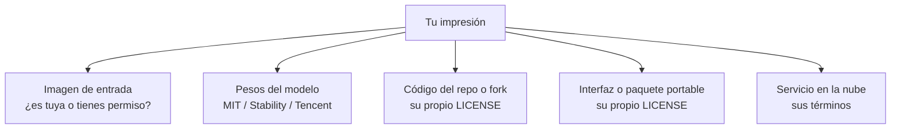

# Licencias de modelos de IA 3D

Parte de: [[39-IA-Modelado-3D/06 Licencias y ética/_Índice Licencias y ética|Licencias y ética]]

> [!info] Cómo avanzar
> `progreso`: **pendiente** → **viendo** (estudiando) → **visto** (contestaste la autoevaluación sin abrir las respuestas) → **dominado** (hiciste el laboratorio o lo aplicaste de verdad).

## Contenido

### Qué es
Cada modelo de IA 3D se publica con una **licencia** que dice qué puedes hacer con el código, con los **pesos** del modelo y, a veces, con lo que generas. No es lo mismo "puedo descargarlo" que "puedo vender lo que imprima con él". En esta área vas a encontrar tres licencias, cada una con su nota: [[Licencia MIT en modelos de IA 3D]], [[Licencia Stability AI Community]] y [[Licencia Tencent Hunyuan 3D Community]].

### Cómo funciona: las tres licencias
| Licencia | Modelos | Uso comercial | Condiciones clave |
|---|---|---|---|
| **MIT** | TripoSR, TRELLIS, TRELLIS.2 (y TripoSG) | Sí | Conservar el aviso de copyright al redistribuir el software; sin garantía |
| **Stability AI Community** | Stable Fast 3D | Sí, hasta 1 millón de dólares de ingresos anuales | Registrarte para uso comercial; política de uso aceptable; no entrenar modelos fundacionales con los resultados |
| **Tencent Hunyuan 3D Community** | Hunyuan3D-2, 2mini (y familia) | Sí, salvo más de 1 millón de usuarios activos mensuales | Territorio: excluye UE, Reino Unido y Corea del Sur; política de uso aceptable; no mejorar otros modelos con los resultados |

Verifica siempre en el archivo LICENSE del repositorio o la tarjeta del modelo: las licencias pueden cambiar entre versiones de un mismo modelo.

### Capas de licencias

La licencia del **modelo** no cubre automáticamente el código de la **interfaz** o del **paquete portable**: cada repo, fork y dependencia tiene su propio archivo LICENSE. Un fork como Hunyuan3D-2GP o un paquete como Hunyuan3D-2-WinPortable puede tener su propia licencia para el código, pero los **pesos** de Hunyuan3D siguen sujetos a la licencia de Tencent. Y si usas un servicio en la nube, además aplican sus términos ([[Servicios comerciales de IA 3D (Tripo y similares)]]).

### Ejemplo: vender llaveros en un bazar
Quieres imprimir y vender 30 llaveros de un ajolote que dibujaste.
- **Con TripoSR (MIT):** puedes vender. MIT no te pide nada por los objetos impresos; sus condiciones aplican si redistribuyes el software o los pesos.
- **Con Stable Fast 3D:** puedes vender si tus ingresos anuales no pasan de 1 millón de dólares y te **registras** con Stability AI para uso comercial.
- **Con Hunyuan3D-2mini:** puedes vender en México (está dentro del territorio), muy lejos del umbral de 1 millón de usuarios activos mensuales.
- **En todos los casos:** el dibujo es tuyo, así que la imagen de entrada está limpia. Ver [[Propiedad y uso comercial de modelos generados por IA]].

### "Código abierto" no significa "sin condiciones"
- Hasta MIT pide **conservar el aviso** de copyright y licencia al redistribuir.
- Las licencias "Community" **no** son de código abierto en sentido estricto: tienen límites comerciales, territoriales y políticas de uso aceptable.
- Casi todas te hacen **responsable** de lo que generas y de que no infrinja derechos de terceros.
- Algunas prohíben usar los resultados para **entrenar o mejorar otros modelos**.

### Cuándo revisar la licencia
- Antes de vender cualquier impresión.
- Al cambiar de versión de un modelo (2.0 → 2.1, TRELLIS → TRELLIS.2).
- Al usar un fork, un paquete portable o un nodo de ComfyUI que descarga pesos.
- Si te mudas o vendes fuera de México (territorios excluidos).

### Errores comunes
1. **Creer que "código abierto" es "sin condiciones".** Lee el LICENSE.
2. **Asumir que el fork tiene la licencia del original o al revés.** Son capas distintas.
3. **Olvidar la imagen de entrada.** Una licencia permisiva del modelo no te da derechos sobre una imagen ajena.
4. **No guardar evidencia.** Anota versión del modelo y fecha en la que leíste la licencia.

### Para profundizar
- [Licencia MIT (Open Source Initiative)](https://opensource.org/license/mit)
- [Stability AI Community License](https://stability.ai/community-license-agreement)
- [Licencia Tencent Hunyuan 3D Community](https://huggingface.co/tencent/Hunyuan3D-2/blob/main/LICENSE)

## Subtemas

- [[Licencia MIT en modelos de IA 3D]]
- [[Licencia Stability AI Community]]
- [[Licencia Tencent Hunyuan 3D Community]]

## Autoevaluación

Contesta primero en voz alta o en papel; luego despliega la respuesta.

> [!question]- ¿Qué tres licencias vas a encontrar en esta área?
> **MIT** (TripoSR, TRELLIS, TRELLIS.2): muy permisiva. **Stability AI Community** (Stable Fast 3D): libre hasta cierto nivel de ingresos y con registro para uso comercial. **Tencent Hunyuan 3D Community** (Hunyuan3D-2 y 2mini): permisiva con restricciones territoriales y de usuarios.

> [!question]- ¿La licencia del modelo cubre también el código de la interfaz o el paquete portable?
> No necesariamente: cada repo, fork y dependencia tiene su archivo LICENSE. Un fork (como Hunyuan3D-2GP) sigue sujeto a la licencia del modelo original.

> [!question]- Error común: creer que "código abierto" significa "sin condiciones".
> Hasta MIT pide conservar el aviso de copyright si redistribuyes el software. Las licencias comunitarias además tienen políticas de uso aceptable y límites comerciales.

## Progreso de los subtemas

```base
filters:
  and:
    - file.inFolder("39-IA-Modelado-3D/06 Licencias y ética/Licencias de modelos de IA 3D")
    - file.name != "Licencias de modelos de IA 3D"
views:
  - type: table
    name: Progreso
    order:
      - file.name
      - progreso
      - nivel
```
