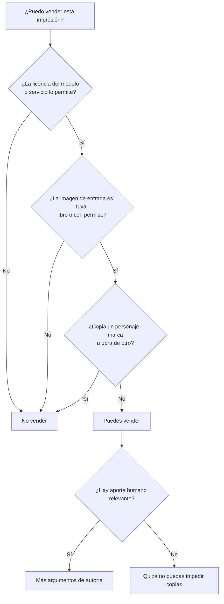

# Propiedad y uso comercial de modelos generados por IA

Parte de: [[39-IA-Modelado-3D/06 Licencias y ética/_Índice Licencias y ética|Licencias y ética]]

> [!info] Cómo avanzar
> `progreso`: **pendiente** → **viendo** (estudiando) → **visto** (contestaste la autoevaluación sin abrir las respuestas) → **dominado** (hiciste el laboratorio o lo aplicaste de verdad).

## Contenido

### Qué es
Es la pregunta de **quién es dueño** de un modelo 3D generado con IA y qué puedes hacer con él: imprimirlo, venderlo, impedir que otros lo copien. Intervienen tres cosas distintas: la **ley de derechos de autor** (en México, la Ley Federal del Derecho de Autor), la **licencia del modelo** o los términos del servicio, y los **derechos de terceros** sobre lo que aparece en la imagen de entrada (personajes, marcas, obras de otros artistas, personas reales).

### Cómo funciona en México
- La ley mexicana reconoce como **autor a la persona física** que crea una obra.
- En 2025, la **Segunda Sala de la Suprema Corte** (amparo directo 6/2025, caso de una imagen hecha con IA) resolvió que las obras creadas de forma **autónoma** por IA **no se pueden proteger** por derechos de autor, porque el autor debe ser una persona ([resumen del caso](https://basham.com.mx/la-suprema-corte-de-justicia-de-la-nacion-confirma-que-las-obras-generadas-por-inteligencia-artificial-no-pueden-ser-registradas-como-propiedad-intelectual-en-mexico/)).
- Cuánta **intervención humana** hace falta para que una obra *asistida* por IA sí se proteja no quedó definido (Pendiente de confirmar).

### Qué implica para tus impresiones
1. **Puedes imprimir y vender** lo que generes si la licencia del modelo lo permite (TripoSR, Hunyuan3D-2mini y SF3D con registro lo permiten; ver [[Licencias de modelos de IA 3D]]).
2. **Quizá no puedas impedir que otros copien** un modelo hecho **solo** con IA, porque podría no tener derechos de autor.
3. **Tu aporte humano** refuerza que la obra sea tuya: un dibujo original como imagen de entrada, escultura y edición en Blender, diseño de colores para CANVAS, base y composición. Documenta el proceso (archivos fuente, capturas, fechas).

### Personajes, marcas y obras ajenas
Aunque la IA "lo haga", un personaje de una franquicia sigue protegido por **derechos de autor y marca** de su dueño. Venderlo es infracción; publicarlo o regalarlo también puede serlo. Las licencias de los modelos te hacen **responsable** de lo que generas. Usa diseños propios o con una licencia que permita ese uso ([[Licencias de modelos 3D (Creative Commons y uso comercial)]], [[Personajes y marcas registradas en impresión 3D]]).

### Ejemplo: la escultura de otro artista
Ves una escultura en un museo, le tomas foto y generas una figura con TRELLIS. **No es tuya:** es una **obra derivada** de la escultura, y su autor (o sus herederos) conserva los derechos mientras la obra esté protegida. La imagen de entrada debe ser tuya, libre (dominio público o licencia que lo permita) o con permiso. Lo mismo con fotos de **personas reales**: pide su consentimiento antes de hacer una figura de alguien, y más si la vas a vender.

Contraejemplo: tu sobrino hizo un dinosaurio de plastilina. Si él (o sus papás) te da permiso, fotografías la pieza, la conviertes con TripoSR, la limpias y la imprimes de regalo: sin problema.

### Buenas prácticas
- Usa como entrada **tus propios dibujos o fotos**.
- Guarda los archivos del proceso (imagen, GLB original, archivo de Blender, 3MF).
- Indica que la forma fue generada con IA y editada por ti.
- Revisa la licencia del modelo y, si usaste un servicio, los términos de tu plan ([[Servicios comerciales de IA 3D (Tripo y similares)]]).
- Para casos de negocio serio, consulta a un abogado de propiedad intelectual.

### Errores comunes
1. **Creer que "lo hizo la IA" te libera.** Eres responsable de lo que generas y vendes.
2. **Usar imágenes de internet como entrada.** Casi siempre tienen autor.
3. **Esperar registrar en INDAUTOR un modelo hecho solo con IA.** Según el criterio de la Corte, no procede si no hay autoría humana.
4. **No guardar evidencia de tu aporte.** Si surge una disputa, tus archivos son tu prueba.

### Para profundizar
- [Ley Federal del Derecho de Autor (Cámara de Diputados)](https://www.diputados.gob.mx/LeyesBiblio/ref/lfda.htm)
- [Resumen del criterio de la SCJN sobre obras generadas por IA](https://basham.com.mx/la-suprema-corte-de-justicia-de-la-nacion-confirma-que-las-obras-generadas-por-inteligencia-artificial-no-pueden-ser-registradas-como-propiedad-intelectual-en-mexico/)
- [Licencia Tencent Hunyuan 3D Community](https://huggingface.co/tencent/Hunyuan3D-2/blob/main/LICENSE)

## Autoevaluación

Contesta primero en voz alta o en papel; luego despliega la respuesta.

> [!question]- ¿Un modelo 3D generado solo por IA tiene derechos de autor en México?
> La Segunda Sala de la SCJN resolvió en 2025 (amparo directo 6/2025, caso de una imagen hecha con IA) que las obras creadas de forma **autónoma** por IA no se pueden proteger por derechos de autor, porque el autor debe ser una persona ([resumen](https://basham.com.mx/la-suprema-corte-de-justicia-de-la-nacion-confirma-que-las-obras-generadas-por-inteligencia-artificial-no-pueden-ser-registradas-como-propiedad-intelectual-en-mexico/)). Cuánta intervención humana hace falta para que una obra *asistida* por IA sí se proteja no quedó definido (Pendiente de confirmar).

> [!question]- ¿Qué implica eso para tus impresiones?
> Puedes imprimir y vender lo que generes si la licencia del modelo lo permite, pero quizá no puedas impedir que otros copien un modelo hecho solo con IA. Tu aporte humano (dibujo original, escultura y edición en Blender, diseño de colores) refuerza que la obra sea tuya.

> [!question]- ¿Por qué no debes generar personajes de marcas o franquicias para imprimir o vender?
> Aunque la IA "lo haga", el personaje sigue protegido por derechos de autor y marca de su dueño; venderlo es infracción y regalarlo o publicarlo también puede serlo. Las licencias de los modelos te hacen **responsable** de lo que generas. Usa diseños propios o con licencia que permita ese uso ([[Licencias de modelos 3D (Creative Commons y uso comercial)]]).

> [!question]- Caso: generas una figura a partir de una foto de una escultura de otro artista. ¿Es tuya?
> No: es una obra derivada de la escultura. La imagen de entrada debe ser tuya, libre o con permiso. Lo mismo aplica a fotos de personas reales: pide su consentimiento.

