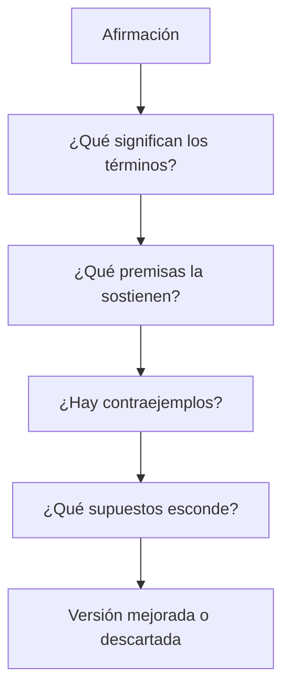

# Pensar con filosofía

Parte de: [[66-Filosofia-Practica/01 Fundamentos/_Índice Fundamentos|Fundamentos]] · Enlaza con [[47-Pensamiento-Critico/_Índice Pensamiento crítico y toma de decisiones|Pensamiento crítico]]

> [!info] Cómo avanzar
> `progreso`: **pendiente** → **viendo** → **visto** → **dominado**.

## Contenido

### Qué es
"Pensar con filosofía" es usar las **herramientas** de los filósofos (no sus conclusiones) para pensar mejor tus propios problemas: definir términos, buscar contraejemplos, separar premisas de conclusiones y examinar supuestos.

### Cómo funciona: cinco herramientas
1. **Definir antes de discutir.** "¿Qué quieres decir con *éxito*?" La mitad de los desacuerdos desaparecen.
2. **Método socrático.** Preguntar "¿por qué?" hasta llegar al supuesto de fondo. Sócrates no daba respuestas: hacía preguntas que mostraban contradicciones.
3. **Contraejemplo.** Para probar una regla general ("todo el que trabaja duro tiene éxito"), busca un solo caso que la rompa.
4. **Experimento mental.** Imagina un caso extremo para probar una idea: "si nadie se enterara, ¿lo haría igual?" (el anillo de Giges, de Platón).
5. **Principio de caridad.** Interpreta el argumento del otro en su **mejor versión** antes de criticarlo.

### Ejemplo
Afirmación de un colega: "Los juniors no deberían opinar en las revisiones de arquitectura".
- **Definir:** ¿"opinar" es votar o preguntar?
- **Premisa oculta:** solo la experiencia produce ideas útiles.
- **Contraejemplo:** un junior detectó la vez pasada un problema de seguridad.
- **Caridad:** quizá le preocupa que las revisiones se alarguen. Propuesta: que pregunten por escrito antes.

### Cuándo usarlo
En discusiones de trabajo, al leer noticias, al tomar decisiones grandes o al escribir. No en una conversación donde la otra persona solo quiere ser escuchada.

### Errores comunes
- Usar las preguntas para **ganar** en lugar de entender.
- Confundir el contraejemplo con "la excepción que confirma la regla": una excepción real obliga a reformular.

### Para profundizar
- [[Las grandes preguntas de la filosofía]]
- Notas de sesgos en [[47-Pensamiento-Critico/_Índice Pensamiento crítico y toma de decisiones|Pensamiento crítico]]

## Autoevaluación

> [!question]- ¿Qué es el principio de caridad?
> Interpretar el argumento ajeno en su versión más fuerte antes de criticarlo.

> [!question]- ¿Para qué sirve un contraejemplo?
> Para refutar o forzar a reformular una afirmación general con un solo caso que no la cumple.

> [!question]- ¿Qué buscaba Sócrates con sus preguntas?
> Mostrar supuestos y contradicciones para llegar a una idea mejor, sin imponer respuestas.

## Práctica

- Elige una frase que repitas seguido ("no tengo tiempo", "así es la industria") y pásala por las cinco herramientas.
