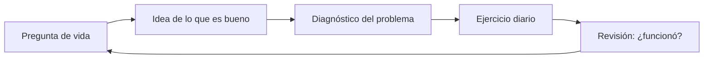

# Qué es la filosofía práctica

Parte de: [[66-Filosofia-Practica/01 Fundamentos/_Índice Fundamentos|Fundamentos]]

> [!info] Cómo avanzar
> `progreso`: **pendiente** → **viendo** (estudiando) → **visto** (contestaste la autoevaluación sin abrir las respuestas) → **dominado** (hiciste el laboratorio o lo aplicaste de verdad).

## Contenido

### Qué es
La **filosofía práctica** es la parte de la filosofía que se ocupa de **cómo vivir**: qué vale la pena, cómo decidir, cómo tratar a los demás y cómo enfrentar lo que no controlas. A diferencia de la filosofía "teórica" (qué es la realidad, qué podemos conocer), aquí la pregunta de fondo es **"¿y esto qué cambia en mi día?"**.

Los antiguos la entendían como un **arte de vivir** (en griego *techne tou biou*): no bastaba con saber, había que **entrenar**. Por eso las escuelas griegas y romanas tenían ejercicios diarios, igual que un deportista entrena el cuerpo.

### Cómo funciona
Tiene tres piezas que se repiten en casi todas las escuelas:
1. **Una idea de lo que es bueno** (la virtud, el placer tranquilo, la paz interior, el sentido).
2. **Un diagnóstico de por qué sufrimos** (deseos desordenados, miedo, juicios equivocados, apego).
3. **Ejercicios** para cerrar la distancia entre lo que piensas y lo que haces: diario, reflexión matutina y nocturna, visualizaciones, preguntas socráticas.

### Ejemplo
Te enojas porque el tráfico te hace llegar tarde a una reunión.
- **Sin filosofía práctica:** te quejas, llegas de malas y la reunión sale peor.
- **Con filosofía práctica:** te preguntas "¿qué depende de mí aquí?" ([[Dicotomía del control]]). El tráfico no; avisar que llegas tarde y llegar tranquilo, sí. Esa noche anotas en tu [[Diario filosófico]] qué hiciste bien y qué harías distinto.

### Cuándo usarla y cuándo no
Úsala para decisiones de vida, manejo de emociones, ética del trabajo y para darte dirección. **No sustituye** atención psicológica o médica cuando hay ansiedad, depresión o crisis: es un complemento, no un tratamiento (ver [[46-Salud-y-Bienestar/_Índice Salud y bienestar|Salud y bienestar]]).

### Errores comunes
- **Coleccionar frases** en vez de practicar. Una cita de Séneca no sirve si no cambia una conducta.
- **Usarla para juzgar a otros.** Los estoicos insistían: el ejercicio es sobre ti.
- **Buscar una sola escuela "correcta".** Puedes tomar herramientas de varias ([[Estoicismo - qué es]], [[Epicureísmo]], [[Budismo como filosofía práctica]]).

### Para profundizar
- [[Las grandes preguntas de la filosofía]]
- [[Pensar con filosofía]]
- [[Lecturas recomendadas de filosofía práctica]]

## Autoevaluación

Contesta primero en voz alta o en papel; luego despliega la respuesta.

> [!question]- ¿En qué se distingue la filosofía práctica de la teórica?
> La práctica pregunta cómo vivir y actuar; la teórica, qué es la realidad o qué podemos conocer. La práctica se mide por los cambios en tu conducta.

> [!question]- ¿Qué tres piezas comparten casi todas las escuelas prácticas?
> Una idea de lo que es bueno, un diagnóstico de por qué sufrimos y ejercicios diarios para entrenar.

> [!question]- ¿Por qué los antiguos la llamaban "arte de vivir"?
> Porque se aprende entrenando, como un oficio, no solo leyendo.

## Práctica

- [[Lab 1 - Dos semanas de diario estoico]]
