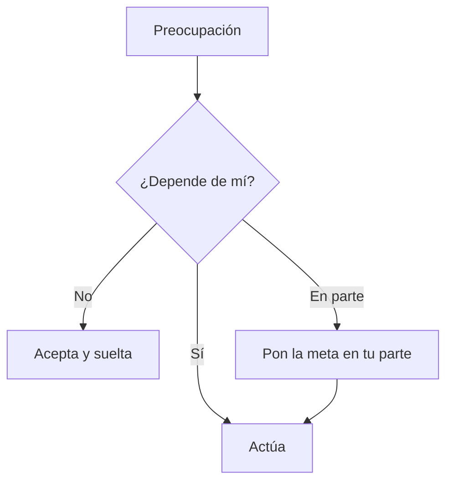

# Dicotomía del control

Parte de: [[66-Filosofia-Practica/02 Estoicismo/_Índice Estoicismo|Estoicismo]]

> [!info] Cómo avanzar
> `progreso`: **pendiente** → **viendo** → **visto** → **dominado**.

## Contenido

### Qué es
Es la idea con la que abre el *Enquiridión* (manual) de **Epicteto**: algunas cosas **dependen de nosotros** y otras **no**. Dependen de nosotros nuestros juicios, deseos, intenciones y acciones. No dependen el cuerpo, la reputación, el dinero, los demás y los resultados. La paz llega cuando pones tu energía en lo primero y aceptas lo segundo.

### Cómo funciona
Ante cualquier preocupación, haz dos columnas:

| Depende de mí | No depende de mí |
|---|---|
| Prepararme para la entrevista | Si me contratan |
| Cómo respondo al comentario | Lo que el otro piensa |
| Dormir y comer bien | Enfermarme o no |

Muchos autores modernos agregan una tercera columna: **lo que influyo parcialmente** (el resultado de un proyecto, la salud). Ahí el truco estoico es poner la meta en **tu parte**: "dar mi mejor esfuerzo" en lugar de "ganar". Es como el arquero: controla cómo apunta y suelta; una vez que la flecha sale, el viento ya no es asunto suyo.

### Ejemplo
Despliegue a producción el viernes: "¿y si falla?".
- **Depende de mí:** pruebas, plan de rollback, avisar al equipo, monitorear.
- **No depende:** una falla del proveedor de nube.
- **Meta interna:** "Dejé el despliegue lo más seguro posible". Si aun así falla, respondes con el plan, sin culparte por lo que no estaba en tus manos.

### Cuándo usarlo
Ansiedad por el futuro, rumiación, frustración con otras personas, espera de resultados.

### Errores comunes
- **Pasividad:** declarar "no depende de mí" algo en lo que sí podrías influir (votar, hablar, pedir ayuda).
- **Hipercontrol:** pensar que el resultado depende 100 % de ti y castigarte cuando falla.
- Hacerlo solo en la cabeza: escribir las columnas funciona mucho mejor.

### Para profundizar
- [[Estoicismo - qué es]]
- [[Estoicismo y manejo del estrés]]

## Autoevaluación

> [!question]- Según Epicteto, ¿qué depende de nosotros?
> Nuestros juicios, deseos, intenciones y acciones.

> [!question]- ¿Qué enseña la metáfora del arquero?
> Que la meta debe ser hacer bien tu parte (apuntar y soltar), no el resultado, que depende también de factores externos.

> [!question]- ¿Qué error lleva a la pasividad?
> Clasificar como "no depende de mí" algo en lo que sí puedes influir.

## Práctica

- Esta semana, cada vez que te preocupes, escribe las tres columnas en tu [[Diario filosófico]].
- [[Lab 1 - Dos semanas de diario estoico]]
