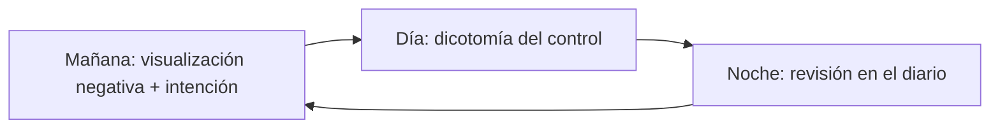

# Ejercicios estoicos (visualización negativa, visión desde arriba y diario)

Parte de: [[66-Filosofia-Practica/02 Estoicismo/_Índice Estoicismo|Estoicismo]]

> [!info] Cómo avanzar
> `progreso`: **pendiente** → **viendo** → **visto** → **dominado**.

## Contenido

### Qué es
Los estoicos no solo pensaban: **entrenaban** con ejercicios espirituales (Pierre Hadot los llamó así). Tres son los más útiles hoy.

### 1. Visualización negativa (*premeditatio malorum*)
**Qué:** imaginar por unos minutos que pierdes algo que valoras (trabajo, salud, una persona) o que algo sale mal.
**Para qué:** (a) agradecer lo que tienes, porque dejas de darlo por hecho; (b) prepararte, porque el golpe imaginado duele menos cuando llega; (c) planear.
**Cómo:** 2–3 minutos por la mañana. "Hoy podría fallar la demo. ¿Qué haría?" Y termina con gratitud: "hoy sí tengo esto".

### 2. Visión desde arriba
**Qué:** imaginarte desde lo alto: tu cuarto, tu ciudad, el país, la Tierra, el universo. Marco Aurelio lo usaba seguido.
**Para qué:** poner los problemas en proporción y recordar que eres parte de algo más grande.
**Cómo:** cierra los ojos 3 minutos y "aléjate" en etapas. Después pregúntate: "¿esto importará en 5 años?".

### 3. Diario y revisión nocturna
**Qué:** Séneca revisaba cada noche su día como un juez amable. Marco Aurelio escribía sus *Meditaciones*.
**Cómo:** tres preguntas cada noche:
1. ¿Qué hice bien?
2. ¿En qué fallé?
3. ¿Qué haré distinto mañana?
Ver plantilla en [[Diario filosófico]].

### Otros ejercicios
- **Incomodidad voluntaria:** ducha fría, ayunar una comida, caminar en vez de usar el carro. Te entrena para no depender de la comodidad.
- **Pausa antes de reaccionar:** contar hasta 10 y preguntarte qué juicio estás haciendo.

### Errores comunes
- Convertir la visualización negativa en **rumiación ansiosa**: es breve, con propósito y termina en gratitud. Si te genera angustia, déjala.
- Escribir el diario solo cuando estás mal: la constancia es la clave.

### Para profundizar
- [[Dicotomía del control]]
- [[Gratitud]]
- [[Estoicismo y manejo del estrés]]

## Autoevaluación

> [!question]- ¿Cuáles son los tres beneficios de la visualización negativa?
> Gratitud por lo que tienes, preparación emocional y planeación.

> [!question]- ¿Qué tres preguntas tiene la revisión nocturna?
> ¿Qué hice bien? ¿En qué fallé? ¿Qué haré distinto mañana?

> [!question]- ¿Cuándo dejar de hacer visualización negativa?
> Cuando se convierte en angustia o rumiación en vez de preparación.

## Práctica

- [[Lab 1 - Dos semanas de diario estoico]]
