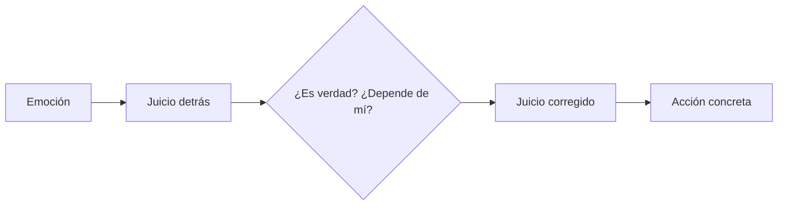

# Estoicismo y manejo del estrés

Parte de: [[66-Filosofia-Practica/02 Estoicismo/_Índice Estoicismo|Estoicismo]]

> [!info] Cómo avanzar
> `progreso`: **pendiente** → **viendo** → **visto** → **dominado**.

## Contenido

### Qué es
Una forma de aplicar el estoicismo a situaciones de presión (fechas de entrega, incidentes en producción, conflictos). No es casualidad que funcione: la **terapia cognitivo-conductual (TCC)** moderna se inspiró explícitamente en Epicteto. Albert Ellis y Aaron Beck reconocieron esa influencia: la idea de que **los pensamientos influyen en las emociones** es estoica.

### Cómo funciona: protocolo en 4 pasos
1. **Nota la emoción y nómbrala.** "Siento ansiedad". Nombrarla ya baja su intensidad.
2. **Encuentra el juicio.** "Estoy pensando que si no termino hoy me van a correr".
3. **Examina el juicio** como lo haría un estoico:
   - ¿Es verdad? ¿Qué evidencia tengo?
   - ¿Depende de mí? ([[Dicotomía del control]])
   - ¿Qué es lo peor realista, y podría soportarlo?
4. **Elige la acción virtuosa:** ¿qué haría aquí una persona sabia, justa, valiente y moderada? Usualmente: hacer lo siguiente que sí depende de ti, y comunicarlo.

### Ejemplo
Incidente en producción a las 11 p. m.
- Emoción: pánico. Juicio: "es mi culpa y todos lo verán".
- Examen: no sé aún la causa; lo que depende de mí es diagnosticar, comunicar y mitigar.
- Acción: aviso en el canal, aplico rollback, documento. La culpa (si la hay) se analiza después en un post-mortem sin culpables.

### Cuándo usarlo y cuándo no
Útil para estrés cotidiano y laboral. **No reemplaza** atención profesional: si el estrés es constante, afecta el sueño por semanas o hay síntomas de ansiedad o depresión, busca a un psicólogo (ver [[46-Salud-y-Bienestar/_Índice Salud y bienestar|Salud y bienestar]]).

### Errores comunes
- Usar la razón para **negar** la emoción ("no debería sentir esto"). Primero se acepta, luego se examina el juicio.
- Ignorar las causas reales: si tu carga de trabajo es imposible, la respuesta virtuosa es hablarlo, no "aguantar".

### Para profundizar
- [[Ejercicios estoicos (visualización negativa, visión desde arriba y diario)]]
- [[Aplicar la filosofía en el trabajo]]

## Autoevaluación

> [!question]- ¿Qué terapia moderna se inspiró en el estoicismo?
> La terapia cognitivo-conductual (Ellis y Beck).

> [!question]- ¿Cuáles son los cuatro pasos del protocolo?
> Nombrar la emoción, encontrar el juicio, examinarlo y elegir una acción virtuosa.

> [!question]- ¿Cuándo el estoicismo no es suficiente?
> Cuando el estrés es persistente o hay síntomas de un problema de salud mental: ahí se necesita ayuda profesional.

## Práctica

- La próxima vez que te estreses, haz los 4 pasos por escrito y guárdalos en tu [[Diario filosófico]].
