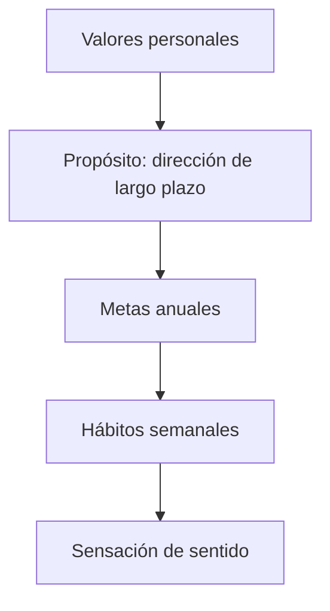

# Propósito y sentido

Parte de: [[66-Filosofia-Practica/05 Vivir con propósito/_Índice Vivir con propósito|Vivir con propósito]]

> [!info] Cómo avanzar
> `progreso`: **pendiente** → **viendo** → **visto** → **dominado**.

## Contenido

### Qué es
El **sentido** es la sensación de que tu vida importa y es coherente. El **propósito** es una dirección de largo plazo hacia algo que te importa y que suele ir **más allá de ti** (personas, una causa, una obra). No hace falta "una gran misión": muchas personas encuentran sentido en criar bien a sus hijos, en su oficio o en ayudar a su comunidad.

### Cómo funciona: tres fuentes de sentido
**Viktor Frankl**, psiquiatra sobreviviente de Auschwitz, escribió *El hombre en busca de sentido*. Propone que el sentido se encuentra en tres lugares:
1. **Crear o hacer:** un trabajo, una obra, un proyecto.
2. **Amar o experimentar:** una persona, la naturaleza, el arte.
3. **La actitud ante el sufrimiento inevitable:** cuando no puedes cambiar la situación, aún eliges cómo enfrentarla.

**Ikigai (idea japonesa, popularizada en Occidente):** el cruce entre lo que amas, lo que se te da bien, lo que el mundo necesita y por lo que te pueden pagar. Úsalo como herramienta de reflexión, no como fórmula exacta.

### Ejemplo
"Quiero ser arquitecto de software" es una meta. Un propósito detrás podría ser: **"construir sistemas que hagan más fácil el trabajo de la gente y enseñar a otros a hacerlo"**. Con eso, mentorear juniors o escribir documentación clara deja de ser "trabajo extra" y se vuelve parte del propósito.

### Cuándo trabajarlo
En transiciones (cambio de trabajo, mudanza, pérdida), cuando sientes que vas en piloto automático, o al planear el año.

### Errores comunes
- Esperar a "descubrir" el propósito de golpe: normalmente se **construye** probando cosas.
- Poner todo el sentido en el trabajo: si pierdes el empleo, pierdes todo. Diversifica: familia, amigos, hobbies, comunidad.

### Para profundizar
- [[Valores personales]]
- [[Existencialismo (Camus y Sartre)]]

## Autoevaluación

> [!question]- ¿Cuáles son las tres fuentes de sentido según Frankl?
> Crear o hacer, amar o experimentar, y la actitud ante el sufrimiento inevitable.

> [!question]- ¿Qué cuatro elementos cruza el ikigai?
> Lo que amas, lo que se te da bien, lo que el mundo necesita y por lo que te pueden pagar.

> [!question]- ¿Por qué es riesgoso poner todo el sentido en el trabajo?
> Porque si lo pierdes, pierdes toda tu fuente de sentido.

## Práctica

- Escribe una frase de propósito (máximo 25 palabras) a partir de tus [[Valores personales]] y revísala en un mes.
